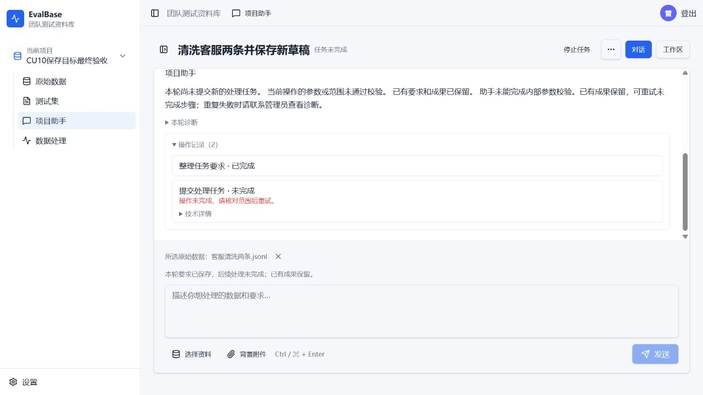

# 第10项保存目标机制修复与真实验收记录

日期：2026-10-25。交付代码：a1d77856c6f455b165c629c9cb88477450157dce；4217 Web、worker、model-worker 均已更新。最终结论：**自动回归通过；真实 Computer Use 未通过，最后补修后尚未重测，Owner pending。**

## 实现

- 处理来源、会话标题和保存目标分开。内部 saveTarget 在现有任务 JSON 中保存，绑定要求指纹，澄清、暂停和继续保留。新建名称不再取任务标题。
- 自然语言、计划、按钮及恢复共用准备/绑定；遗漏必要保存参数进入既有有界纠错。旧任务仅从当前明确带引号要求只读兼容，不批量回填。
- ‘这N条’只在已确认来源真实全量一致且无部分/勾选/固定范围冲突时绑定真实ID。
- 执行已就绪的简单处理，可证冗余确认直接归一后仍进行完整校验；未就绪请求、真实缺口和原纠错上限保持。
- 最后一次CU发现模型传入 metadataKeys:[__none__]，与已保护Metadata冲突。补修仅在当前和本次允许字段均保护Metadata时去除这一精确空选择标记；真实键和允许修改Metadata时仍完整验证。无新增表、公开路由、框架或预算默认。

## 自动证据

128项不同定向用例通过：7项真实AI SDK/HTTP夹具/隔离数据库；82项保存目标及处理准备单元；35项规划问题合同；4项已有保存入口回归。TypeScript、相关ESLint及正式前后端构建通过。初始保存目标缺失及最后占位符故障均有先红后绿证据。相关检查沿用未受后续变化影响的通过结果。

完整SDK用例实际完成两种范围的命名、清洗、暂停/继续、按钮保存、确认、打开草稿及重复确认；核对名称、字段保护、草稿ID/回执一致和不重复创建。这些是自动夹具结果，不能替代真实模型验收。

## Computer Use 与累计预算

只测试第10项，其他已通过项未重跑。每次独立新会话；后续尝试只分配本轮剩余量，不清零之前使用量。所有测试材料是独立项目内的合成客服JSONL，操作经侧栏浏览器。API只准备资料和限额，未代替助手提交或保存。

| 尝试 | 应用代码 | 真实请求 | 模型请求耗时 | 活动执行耗时 | 结果 |
| --- | --- | ---: | ---: | ---: | --- |
| 首次 | 2c83cec | 5 | 39658ms | 41926ms | 名称已持久保存；多余复述确认后再次询问范围，未提交 |
| 澄清补修后 | b02913b | 8 | 53347ms | 55760ms | 重复确认被拒绝，模型纠错仍重复；原自动纠错上限停止 |
| 确定性归一后 | aa24db2 | 4 | 65009ms | 66768ms | 页面先选择两条来源；仍有一次多余字段确认；普通确认后，模型Metadata空选择标记导致校验失败，下一次纠错受验证时间预留拦截 |
| **累计** | — | **17** | **158014ms** | **164454ms** | 三份账本均关闭；低于本轮20次/180000ms总上限 |

最后一份限额还剩请求次数，但时间预留不足以安全发起下一次请求；不能表述为‘20次全部耗尽’或‘模型超时’。所有已发出的HTTP均返回，未通过调整限额继续重跑。当前版本a1d7785补修发生在真实验证关闭后，未再次调用模型。

会话：

- [首次来源澄清](http://127.0.0.1:4217/projects/project_828082ac0d5149608d03e6d7d7659dc5/assistant/conversation_1592308c3e194e83af354430d0ee1f3d)。
- [原纠错上限停止](http://127.0.0.1:4217/projects/project_084ea5b767cc4e5d909f3da328b7de90/assistant/conversation_fc5df1c5d4a04999a72ceef0cdf5be44)。
- [最后一次真实结果](http://127.0.0.1:4217/projects/project_e2a0dab7acc24c849ec739240f7b7c30/assistant/conversation_56b3a962f0d74c72bf2ce4f7d72b58f1)。

## 保留与未闭合项

18类原有业务行与56份旧预算指纹核对保持；原有semantic-results.json工作区改动保持。部署前备份留在服务器本目录。数据库、对象存储、卷和既有验收数据未删除，临时请求守卫已退出，模型默认预算未调整。

尚未闭合：在最新版本使用普通提示，实际完成清洗→候选核对→确认卡→指定名称草稿→刷新核对；多余字段确认仍需观察优化。当前真实数据没有处理运行、候选或新草稿，不能据自动回归声称真实闭环通过，也不能据名称持久保存声称第10项整体通过。下一轮如授权，应另立小额账本，只复测这一保存闭环并保留本轮记录。

范围、风险和限额见[实施方案](plan.md)与[审阅记录](review.md)。
