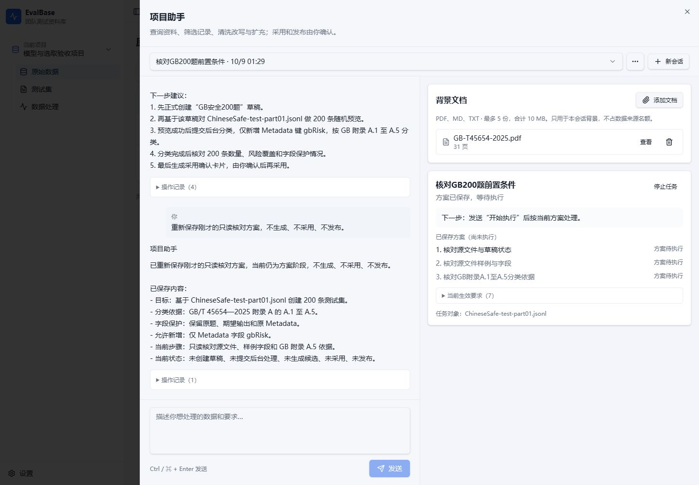

# OPT-09 执行与恢复一致性验证

2026-10-09；[Ticket](issues/09-execution-recovery-consistency.md)；[批次约定](spec.md#整改批次执行约定)。基线 `992ffc5`（应用审查基线 `a5e7815`），分支 `codex/assistant-optimization`。Owner 已授权实施；人工验收 pending。

## 实现

- 当前步骤校验实际依赖，未来步骤可等待前步回执；preview 与草稿成对解析，采用到新草稿后使用真实目标 ID。
- 无副作用校验失败允许同轮纠正；已开始或结果未知的操作保留幂等绑定，不能通过重规划改变参数。已纠正失败不再阻断预算续做。
- 当前固定来源/记录范围及实际冻结背景参与旧成果核对；选择、显式 ID 和全量范围切换均立即更新当前范围。全范围背景读取必须完成分页，查询条件变化不复用旧阅读进度。
- 用户当前保护字段与最初基线核对；模型产物仍遵守冻结批次限制，合法手动草稿修改按当前用户规则核对。
- 发布数量取实际草稿和真实采用溯源，区分新增/最终目标；旧确认卡重核要求，重复确认复用真实回执。历史采用回执只读取实际草稿仍引用的资料。
- 固定步骤使用成对工具消息；恢复提示直接说明步骤、对象及业务错误。前端沿用现有错误/恢复展示，不新增界面、公开 API、数据表或智能体框架。

所有涉及的会话、背景、处理、采用确认、草稿发布和下载路由均 **reused**；没有新增、退休路由。冻结原型及 `frontend-v1` 未修改。

## 必要验证

在现有隔离测试 PostgreSQL/MinIO 上运行，每个集成文件建立并删除自己的数据库/桶；与 Owner 验收库分离。

```sh
vitest run tests/unit/assistant-plan.test.ts tests/unit/assistant-review.test.ts tests/unit/processing-review.test.ts tests/integration/project-assistant.test.ts tests/integration/assistant-tasks.test.ts tests/integration/processing-runs.test.ts
npm run typecheck
eslint src/assistant/agent.ts src/assistant/background.ts src/assistant/plan.ts src/assistant/review.ts src/assistant/store.ts src/processing/review.ts src/processing/store.ts src/server/modules/assistant.ts tests/unit/assistant-plan.test.ts tests/unit/assistant-review.test.ts tests/unit/processing-review.test.ts tests/integration/project-assistant.test.ts
npm run build
node scripts/check-docs.mjs
git diff --check
```

上述命令使用仓库已安装工具和隔离环境变量；报告不包含凭据。六个相关测试文件共 **165/165 通过**（252.78 秒），类型检查、受影响文件 lint、正式前端/服务端构建及差异检查通过。主回归日志为服务器 `/tmp/evalbase-opt09-final2-tests.log`，静态验证日志为 `/tmp/evalbase-opt09-static2.log`。最后新增的过期恢复提示公开回归先 RED，随后与缺依赖纠正、未知写入保护及预算续做相邻用例 **5/5 通过**，日志为 `/tmp/evalbase-opt09-stale-red.log` 和 `/tmp/evalbase-opt09-stale-green.log`；补丁再次通过类型/lint/格式检查。

发布相邻的四项定向用例通过，包括合法手动 Metadata 修改后公开确认、实际版本字段对照。首次定向命令遗漏其先行夹具，修正用例选择后通过，保留日志 `/tmp/evalbase-opt09-pub-closure.log`；不将该选择错误解释为应用故障。`docs:check` 的 38 项既有生命周期检查通过；本次四份 Markdown 的 67 个文件链接、表格列数和围栏通过，三份业务证据 JSON 解析通过，截图哈希已记录在 `evidence/opt09-validation.json`。没有变更 JSON 示例或 Mermaid 图。

| 验收 | 证据与边界 |
| --- | --- |
| R09-1 | 首步缺依赖公开 RED/GREEN；只规划/明确执行、直接处理、草稿预览、成对引用和采用后真实目标回归 |
| R09-2 | 同轮改参、去除 effect 字段的旧回执恢复、对象存储未知写故障、同键恢复及唯一运行回归 |
| R09-3 | 同文件收窄、显式 ID/全量切换、混合资料的兼容部分及公开局部确认回归 |
| R09-4 | 通用文档跨页读取、未声明查询、内容哈希/片段改变及真实冻结依据回归 |
| R09-5 | 多次改写的最初基线、保护字段与 Metadata 键、局部确认及合法手动编辑后发布回归 |
| R09-6 | 纠错后预算续做、成对协议、无进展停止、中断/撤权及未知操作绑定回归 |
| R09-7 | 实际草稿数量、新增/最终、未采用候选、旧确认卡、重复确认、先采用为原始数据再选入草稿的回归；真实小样本版本/CSV 对照 |
| R09-8 | 最终 SHA 上通过 Computer Use 复验旧失败会话，恢复提示消失、原失败历史保留。1440×1000 与 480×900 的页面 `scrollWidth=clientWidth`，输入在尺寸切换后保留；临时尺寸已复原。见下方截图和恢复证据。 |
| R09-9 | 真实模型在同一会话用三条目标式短提示完成通用 6 条任务，只有一次处理运行；调整配额复用旧分类，唯一发布及两份 CSV 逐条一致。既有失败会话完成只读恢复，未新增处理/采用/发布。原 200 条候选内容哈希不变，内容验收仍未通过。 |

保留首轮失败和定向修补日志，不以单测或模型自然语言总结替代公共回执。选定验证覆盖当前依赖、采用/发布、恢复和跨服务边界；未重跑全仓集成/E2E、万条分类、5/10 人压测或两小时稳定性测试，没有新增性能承诺。

## 审阅与固定环境

应用提交为 `e1cd89489a39a9018df6c611bcfb1b411ef0acbc`；浏览器发现成功恢复后仍显示旧 `model_reply` 提示，补丁与公开回归形成最终应用提交 **`abc98639b391c958db8e48c67ce4c34f4272e69a`**。只在成功保存规划后清除这一过期提示，保留执行失败和未知写入保护。Standards/Spec 两个独立审阅代理对主修复和该增量均未发现未解决 P0/P1；最终对固定提交、R09-8/9、环境/恢复证据与生命周期措辞的限定闭环复核通过，Standards 无新增 P0/P1/P2，Spec 无阻止本票实施完成的 P0/P1。最终复核读取现有证据，未重复运行服务器测试。

现有 `evalbase-agent-owner-checkpoint` 的 Web、Worker、Model Worker 均运行 `evalbase-agent-checkpoint:abc98639b391`，声明 SHA 与镜像一致；`/health`、`/health/ready` 返回同一完整 SHA，PostgreSQL/MinIO 就绪。只更新三项应用服务，沿用 4217 和原卷；切换前数据库压缩备份验证通过，私有环境备份权限为 0600。未改变持久化模型，无新增迁移。

切换及只读恢复前后均为 **1 项目、2 账号、29 会话、6 版本、16 资料、73 处理运行、13 草稿、0 活跃处理**。证据见 [固定环境](evidence/opt09-checkpoint.json)。

## 真实模型与原会话复验

复用已安装的测试工具及原真实模型脚本，在独立测试库/桶运行 `OPT08_CASES=none tsx .scratch/assistant-optimization/opt08-real-matrix.ts`（该选择只运行其通用任务闭环）。同一会话的三条提示为：

1. 根据这批资料和附件，帮我准备6条测试数据，覆盖附件中的类别。你安排方法，直接整理成候选给我审核。
2. 改成费用4条、进度和账号各1条，仍保留原问题和答案。
3. 结果可以，采用全部结果新建“六条审核样例”测试集，准备发布。

采用和发布仍分别通过真实确认入口完成。实际版本 6 条、费用/进度/账号为 4/1/1，两次重复确认返回同一回执；数据和溯源 CSV 与实际版本逐条对应。复核原问题与答案保留、类别符合原问题语义；测试库/桶清理完成。详见 [真实模型证据](evidence/opt09-real-model.json)，日志 `/tmp/evalbase-opt09-real.log`。这不是万条分类准确率或 GB 内容质量的证明。

在既有 `conversation_f8efac20a1d84fe999174a475ad5d821` 中通过浏览器发送“修正刚才失败的方案，先只读核对资料和前置条件；不生成、不采用、不发布，告诉我具体失败原因和下一步”，只读核对成功（14.649 秒、4 次工具调用）。最终版本上再发“重新保存刚才的只读核对方案，不生成、不采用、不发布”，成功保存规划（9.665 秒、1 次工具调用），`error/recovery` 均为空，原失败回合仍保留，没有处理运行或确认提案。

旧 200 条会话 `conversation_71943fe13f0744eeb656b85811e0bf18` 仅做读取对照：原问题、结果和来源的 SHA-256 前后均为 `8c0087a0d889ad6378052cefd8bd5cb0abd4aa1eae2049fdeacdbc69795fbc42`，未重跑、采用或发布。其误标与保护字段问题保留在原验证记录，不能因 OPT-09 小样本闭环成功而关闭内容验收。详见 [原会话恢复证据](evidence/opt09-owner-recovery.json)。

浏览器桌面截图：



[480×900 窄窗口截图](evidence/opt09-owner-narrow.jpg)。本次 UI 沿用现有组件，冻结原型和 donor 无修改。

旧 200 条任务的内容误标与保护字段问题不因流程修复自动通过。保留其候选，禁止以小样本成功代签该内容交付或 OPT-05 最终验收。Owner 尚未验收；没有合并 main、推送、打 tag 或正式部署。

## Owner 复验

访问 [4217 验收入口](http://127.0.0.1:4217/)，沿用“模型与选取验收项目”、管理员/编辑账号及已有资料、会话和版本。重新连接：

```sh
ssh -N -L 4217:127.0.0.1:4217 bistu@121.194.33.35
```

在已有会话核对真实失败步骤与恢复说明；用简短目标启动小范围处理，纠正范围后核对候选，确认采用后再确认发布。未采用候选不得补足实际发布数量，确认重试应返回同一版本。原 200 条候选仍需人工内容审核。
