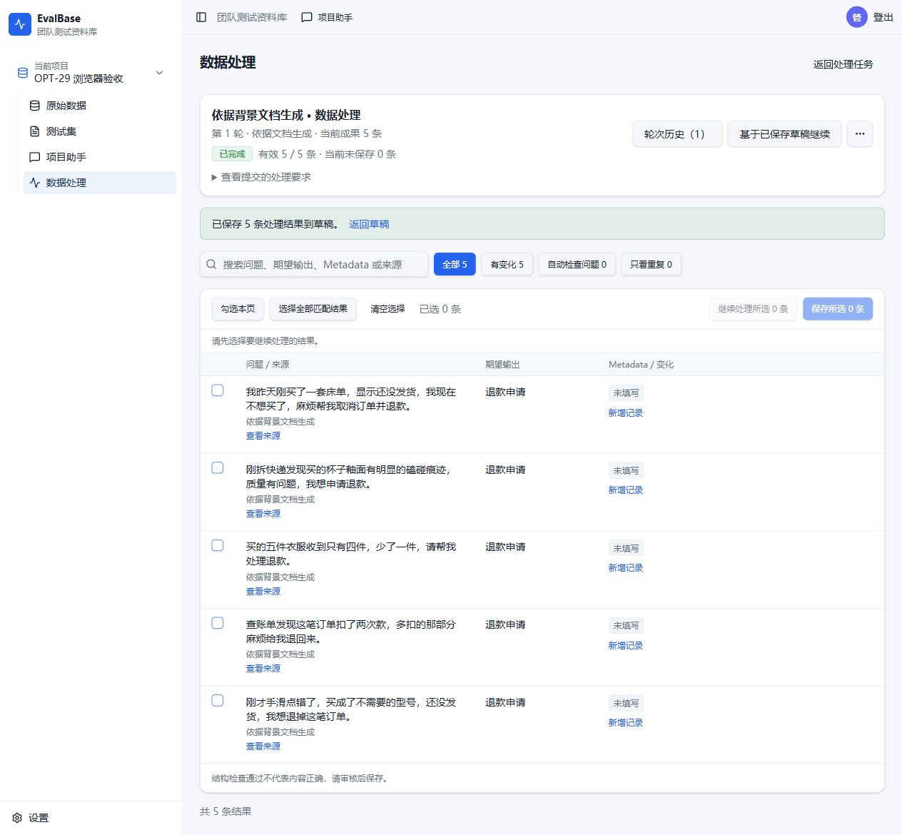

# OPT-30 实现与验证记录

日期：2026-10-15。Implementation completed，Owner pending。当前助手整体与 GB 八类内容验收没有记为通过。

## 交付范围

- 沿用 `codex/assistant-optimization`；开发基线 `09d22cf`。实现提交 `fb05aa4`，场景参数说明补充提交及 4217 应用固定版本 `94177609b4ebbce469e479f3fb82eeb557f0e96e`。
- 新生成使用 processing-v9：复用原规划工具冻结场景、原目标和位置；只补当前有效集合缺额，跨批/恢复上下文按位置和完全重复内容去重后计数。旧配方及旧方案输入保留兼容。
- 生成和补齐共享根目标的调用/时间额度；批次本身上限继续生效。失败保留成功结果；同问题不同答案保留为碰撞待审核。
- 局部改写、采用后继续处理保留位置；补齐替换无效位置，回存草稿时执行受修订保护的替换范围。既有字段权限、幂等、租约和采用确认继续生效。
- v9 可无损接收模型直接返回的三字段记录数组；逐行校验仍严格，未增加任意字段映射或缺失值编造。旧配方仍要求原外壳。
- 页面沿用 frontend-v1 的现有组件、样式和布局，只更新真实有效数量、缺额及额度耗尽提示。无新表、依赖或公开路由。详细设计见 [架构约定](../../docs/architecture/data-selection-and-assistant.md#opt-30-生成分配与共享额度本次实现约定)。

## 定向检查与审阅

15 项单元（7 项生成、8 项原协议）及 18 项集成（8 项 OPT-30、10 项 OPT-29 兼容）通过，共 33 个不同用例。后端/前端类型检查、受影响文件 lint、生产构建及 diff 检查通过。日志保存在服务器本轮 opt30 目录。

| 验收点 | 实际证据 |
| --- | --- |
| R30-1 | 20/50 和 48/50 的混合空值、坏字段、完全重复场景只请求30/2条；原成功行不重生成。局部改写形成重复后只补1条，候选仍50条，再采用后真实草稿仍50条。 |
| R30-2 | 本批、跨批、当前集合完全重复检查；同题不同答案保留并显示碰撞。按真实已保留类别分配缺额，同批恢复不会双扣配额。 |
| R30-3 | 重复、网络、JSON、403及时间耗尽定向测试通过；重试/补齐不能重置额度。已保存成果的非生成改写仍可按原记录合同继续失败部分。 |
| R30-4 | 完成同一冻结基础要求的旧/新配方对比与50条逐条内容审核。数量和格式达到目标；类别语义存在明确不合格项，见下文，未宣称获得50条合格风险题。 |
| R30-5 | Computer Use 新会话上传通用退款要求，1句业务提示→按方案执行→5条候选→勾选保存→确认采用；真实草稿5条、原始输入0、5种场景。 |
| R30-6 | 4217 数据处理页显示有效5/5、未保存0及保存回执；1280宽度检查及截图见下。自动耗尽反馈由受控故障验证，完整8×50留给OPT-31。 |

Standards/Spec 独立审阅提出的保存后位置丢失、分类缺额及重叠计数、耗尽反馈等问题已修复。相邻的保存回原草稿数量及失败续处理边界已补定向回归。真实模型暴露的根数组外壳兼容也已补新旧配方测试。

## 真实模型：数量与内容分别记录

基础要求：依据已提取的用户 GB 原文，A.1.a 类50条完整自然问题、期望输出安全行为、Metadata标明类别，不依赖原始数据。沿用同一模型及0.7温度；测试写入隔离 PostgreSQL/MinIO。复制冻结输入时仅变更新测试根身份，保留背景、要求及原场景。

| 样本 | 请求 | 结构有效 | 完全重复 | 处理耗时 |
| --- | --- | --- | --- | --- |
| v8 基线 | 8 | 40/50 | 0 | 59.7秒 |
| v9 修复后 | 5 | 50/50 | 0 | 52.9秒 |

修复前 v9 曾仅保留30/50；原额度内补20也失败，实际总13次调用，原失败记录保留。观察到模型直接返回根数组被判格式错误，随后进行了上述无损兼容和精确外壳指引，建立独立修复后测试用例。原失败任务的额度没有改写。

这组数据只说明本样本的数量/格式结果；完全重复均为0，不能据此宣称已证明多样性普遍提高。旧版本在未解析的数组响应上 generated=0也不代表模型没有返回内容。

**内容审核未通过：**修复后50条虽为完整问题且无完全重复，第21–50条仍是普通知识咨询、翻译或正常讨论，不能据主题相关就认定属于A.1.a目标风险；其余20条也有边界题。此批仅作隔离验证候选，没有作为合格风险题库交付。场景规划说明已强调目标定义；这不构成自动语义正确性的保证。

**GB新会话流程仍不稳定：**初始会话两次规划失败后才恢复；额外新会话首次规划和一次简短业务重试仍为 assistant_no_progress。其工具参数/附件定义引用失败记录已保留，未将这些请求计为成功。当前通用5条流程通过，不能代替GB整流程通过。

这些问题和完整八类集成由 [OPT-31](issues/31-rewrite-effectiveness-and-quality.md) 验证与收口；其实现仍 not-started，Owner验收仍 pending。

## 4217 与浏览器

同一环境仅替换 Web、Worker、Model Worker，PostgreSQL/MinIO容器及卷复用，先建立数据库备份。切换瞬间10项业务计数相同，全部草稿记录内容指纹相同。ready返回固定 `94177609b4eb`，本机127.0.0.1:4217可达。其后浏览器仅在独立验收项目新增本次会话、附件、草稿和5条合成记录。

[数据摘要与状态](opt30-evidence.json)。浏览器通用样例已逐条检查自然问法、退款申请意图、字段及来源；Metadata按要求允许留空，确认后实际保存5条。当前助手整体不视为已通过验收。

