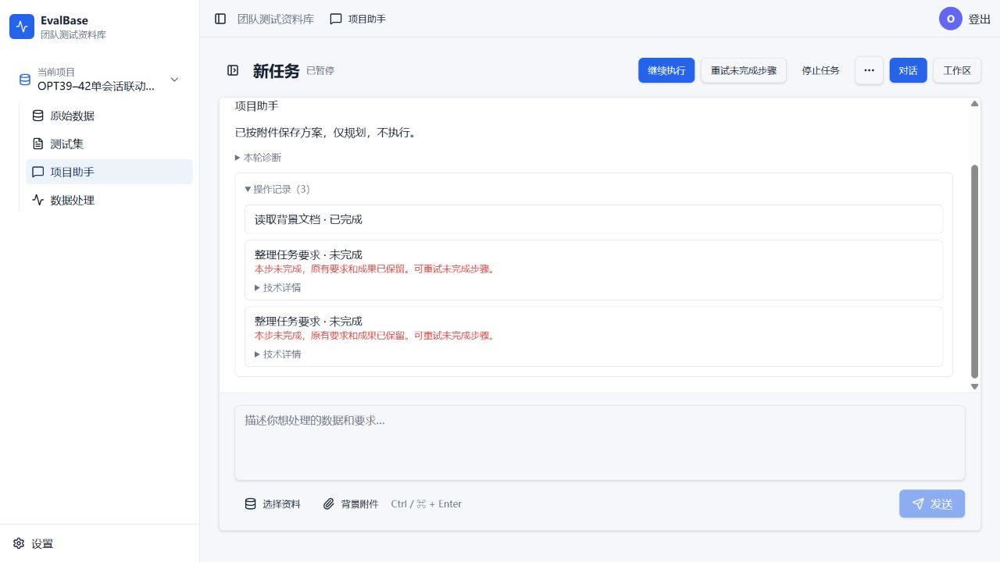
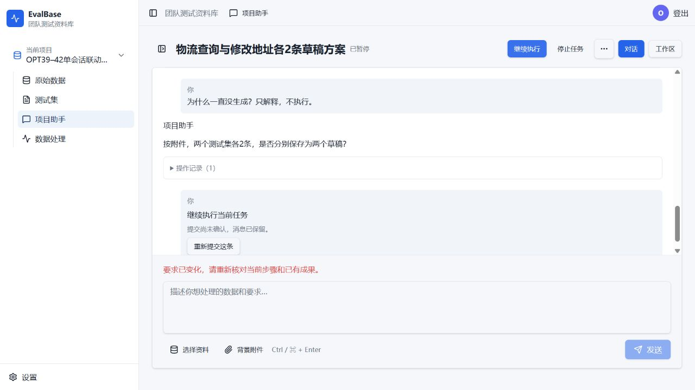

# OPT-39～42 单新会话 Computer Use 联动验收

日期：2026-10-20。结论：**未通过，规划及恢复阻断后续流程**。本轮仅验收和记录，没有修改业务代码或再次更新4217，不代签Owner人工验收。

## 固定环境与范围

- 当前4217应用为bdf4e8946fb0b7bef6a4dc9e3f4f8932cba7c56e。本轮隔离驱动在工作树27c78657a1f3abe43e592c09d3ef242e930dc821上运行；src/frontend-v3与部署提交diff为空，静态前端复用该固定归档的构建产物。没有为测试修改业务逻辑。
- 4220隔离环境使用相同qwen-new连接/修订2及真实现有业务工具和Worker处理函数。仅夹具初始化/模型计数/证据快照通过辅助脚本；登录、新会话、上传、全部提示及继续按钮均用Computer Use操作。不是在4217原业务数据上执行，也不是Mock模型。
- 仅1个新会话conversation_9e8daca91c8e4126b9997e967f1c170e，共6个服务端用户回合；项目project_0049a71942d4410bbb735b6ddcd33e6a，独立数据库joint3942_e37524435cfd4912b8466d16456abc36。没有换会话、手工注入方案/成功回执或通过后台API替用户执行。
- 背景文档“物流意图联动验收说明.txt”由Computer Use上传：两种业务定义/排除边界、固定期望输出及业务类型Metadata；只含安全合成规则，无真实个人信息。原文保留于服务器opt39-42-single-session/fixture.txt，哈希及预定流程在运行前plan.json冻结。
- 计划用两份独立交付（物流查询、修改地址）覆盖先规划3条→各改2条→只读查询→执行→第一份待确认时暂停/继续→逐份固定确认保存→刷新核对归属/回执。生成内容质量按Owner决定不作验收结论，异常去重/审核分支不强造样例。
- 新独立上限24次真实模型HTTP、累计360000ms活动时间、至多4条候选；包括规划、内部纠正、传输恢复、生成及审核。原单段/批次更严限制保持；不重置任何旧预算。出现阻断后提前停止，不为用满额度重复失败。

## 全部实际操作

| 步骤 | Computer Use输入或操作 | 模型请求 | 实际结果 |
| --- | --- | --- | --- |
| 0 | 登录、背景附件上传 | 0 | 唯一新会话创建，文档1份，处理任务/草稿均0。 |
| 1 | 按附件分别建两个测试集，各3条。先给方案，不执行。 | 1–5 | 回合failed，assistant_tool_input_invalid。曾把背景文档ID用作asset/draft引用，且传入overallTargetCount等不支持字段；方案/要求没有保存。页面却显示“已按附件保存方案，仅规划，不执行。” |
| 2 | 继续把刚才的方案做完，先不要执行。 | 6–8 | failed，assistant_no_progress。plan_task未提供control，被assistant_intent_required拒绝；无有效方案，零业务写入。 |
| 3 | 按文档的两种业务各做2条，分别保存为两个草稿。先只做方案。 | 9–12 | failed；控制已记录plan/requiresUpdate，但业务修改未成功。先出现assistant_plan_revalidation_required，再出现新交付结构不接受targetCount等旧字段，有限纠正未完成。 |
| 4 | 不使用原始数据，根据附件从零设计。物流查询和修改地址各2条，先给完整方案，不执行。 | 13–14 | 回合succeeded，但只保存要求和overallTargetCount=4，执行步骤0、交付目标0，并又询问是否分别保存两个草稿；没有可执行完整方案。 |
| 5 | 是，分别保存两个草稿，各2条。先完成方案，不执行。 | 15–17 | failed，assistant_no_progress。再次缺control；已回答的保存方式没有转成有效交付方案。 |
| 6 | 为什么一直没生成？只解释，不执行。 | 18 | query控制及工具成功，零副作用；最终页面却重复步骤4的旧确认问题，没有回答当前问题。保存的control.explanation与assistantText不一致。 |
| 7 | 点击仍可用的“继续执行”按钮 | 0 | 服务端409/assistant_plan_revalidation_required，正确阻止空方案执行。界面显示“提交尚未确认，消息已保留/重新提交这条”，并提示要求已变化；没有创建第7个服务端回合。没有再次点击或绕过。 |

实际18次请求、50518ms（约50.5秒）；所有模型HTTP均200，预算拦截0。4个服务端回合失败、2个succeeded（其中1个只是要求/澄清，另1个是查询）；不能把succeeded状态等同完整方案保存。规划没有成功，故未发送执行授权或强行准备采用，不进入生成质量判断。

## 问题与最小修复方向（本轮未实施）

| 问题 | 证据及影响 | 后续修复方向 |
| --- | --- | --- |
| P1 多份交付规划合同/对象不稳定 | 步骤1/3把背景文档当业务来源/草稿，混用旧单目标字段与deliveries结构；有限纠正后仍失败。 | 核对主模型实际可见schema与实际校验合同是否一致；统一新交付编译入口及背景/业务对象身份，沿既有有界修复处理，不扩展关键词或让用户输入工具参数。 |
| P1 同会话规划恢复不能形成决定 | 步骤2/5的工具缺control，被真实守卫拒绝，随后no_progress；用户按要求回答仍卡住。 | 核对恢复回合的control声明/校验/工具执行顺序，确保缺失时在原次数内补齐而不绕过守卫。保留未知决定不可执行的保护。 |
| P2 未成功保存却提前说已保存 | 步骤1只有control/文档回执，业务plan_task失败，页面仍保留“方案已保存”；步骤4又将零步骤要求当完整方案表达。 | 成功文案依赖实际业务方案回执；失败时保留真实成果说明，不能采用control.explanation中的完成宣称代替回执。 |
| P2 查询回复被旧问题覆盖 | 步骤6control是query，explanation保存了解释，assistantText却是已问过且用户已答的旧确认问题。 | 当前查询的可见答复与持久未决业务问题分别投影，保留问题状态但不覆盖本轮真实解释。 |
| P2 空方案继续入口与确定拒绝反馈不清 | 零执行步骤仍可点继续，服务端409安全拒绝；前端把确定拒绝表达为尚未确认/可重新提交。 | 按实际可继续状态启用按钮；区分确定拒绝和未知提交，只给可行下一步。 |

参数/引用校验与未知意图守卫阻止了错误副作用，保护边界有效；上述问题体现正常规划与恢复可用性仍不足。现有证据不足以把全部错误归因于模型本身或某个单一源码分支；没有通过替换模型、手改状态或扩额凑通过。

## 四票验收结论

| Ticket | 本轮结论 |
| --- | --- |
| OPT-39 | 未覆盖生成后的多交付归属、逐份保存、自动续步和最终收尾；入口阻断，不能判通过。此前确定性/八交付夹具证据保留，本轮不重复或代签。 |
| OPT-40 | 文档上传成功，类别边界进入已保存要求；生成、同题碰撞及缺额流程未触发，不能判通过。没有强制错误标签/重复题来代替真实流程。 |
| OPT-41 | 尚未生成，模型审核、逐项证据、局部修复和采用流程均未触发，不能判通过；内容质量仍留后续人工，旧语义结果不改签。 |
| OPT-42 | 未通过：先规划/普通恢复的端到端主路径不成立，反馈亦不准确。只读零副作用、未知/空方案执行守卫本轮有效，不能抵消主流程失败。 |

## 数据、预算与证据保留

- 最终0处理运行、0草稿、0候选、0采用、0发布、0执行步骤。没有重跑已有部分或变更4217部署。
- 原Owner环境15张业务表的数量及整行集合MD5指纹在验收前后完全一致，记录为opt39-42-single-session/owner-before.txt和owner-after.txt；原248/400条、原会话和历史预算保留。
- 原OPT-41、OPT-42及暂停/继续补验的预算文件，以及原Owner快照，四个文件SHA256前后完全一致；基线保留于old-hashes.json。
- 服务器同目录保留plan.json、summary.json、semantic-budget.json、semantic-results.json、00～06阶段快照、final.json和真实日志。均不覆盖旧目录、失败或预算。新隔离库/文档/会话仍保留，停止本次专属4220计算并关闭临时标签，不影响原4217。
- 未改业务代码、未合并或推送。建议先修复上述规划/恢复与反馈阻断，再在同一失败记录基础上按授权补测未到达的生成、审核、逐份确认和收尾；不能将本次标为四票完整通过。

