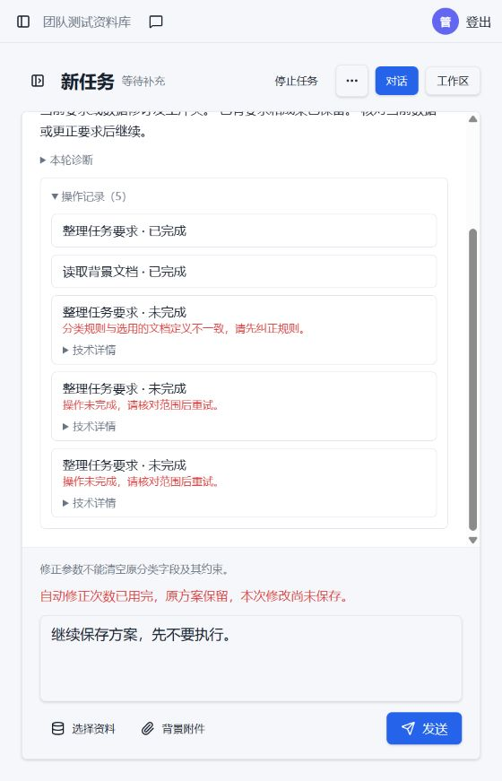

# OPT-46：4217更新及第7项独立Computer Use复测

日期：2026-10-22。Owner本轮明确授权提前更新4217并另开一次有上限的CU-7。**结果：未通过，失败发生在首次保存方案；未到达既有方案核对和数量修改阶段。** OPT-46的受控开发验证见[原记录](opt46-verification.md)，原86项自动回归不能代签本次真实验收。

## 固定环境与执行边界

- 应用：91085699a023f14ed54cd34ee7356be4fce3c4d8，镜像evalbase-agent-checkpoint:91085699a023；git archive构建，未包含batch1-repair/semantic-results.json的预存未提交变动。实际产品实现625c44a、补充回归68d399b，9108569为其文档后继。
- 4217的Web与Model Worker同版；PostgreSQL、MinIO及普通Worker保持原容器。/health、/health/ready、前端静态资源及浏览器刷新后的后端页面读取通过。数据库先备份，旧卷和配置保留。
- 模型沿用qwen-new、配置revision=2、原端点及原密钥，未改配置或另发连通性测试。
- 唯一新项目：project_00b45054bb814b13a2a00a2444115583；唯一新会话：conversation_e6cf8111e7ad49988ed884a6e0fe0272。
- [打开失败会话](http://127.0.0.1:4217/projects/project_00b45054bb814b13a2a00a2444115583/assistant/conversation_e6cf8111e7ad49988ed884a6e0fe0272)。项目创建、两份附件上传、业务提示和普通继续均由侧栏Computer Use完成；只读SQL用于核对实际回执、预算和产出，没有从后端补方案或数据。
- 独立campaign：opt46-cu7-20261022。最多24次实际外部请求、240000ms活跃执行、1个会话、最多1次普通继续；生成/采用均为0。更紧的产品修复额度仍生效，没有借外层额度追加同一修改的纠错机会。

本次只提前授权CU-7；没有实施OPT-47～50，也没有执行CU-10或重跑第1～6、8～10项及旧248/400条。

## 材料与普通提示

通过页面上传旧版与新版两份合成小客服规范；旧版名为“分类一/分类二”，新版将真实类别名列为“退款进度/退款到账时间”，新版文件声明优先于旧版。材料全文、固定提示及额度执行前已登记在opt46-cu7-20261022/plan.json。

1. 实际发送：“按新版做一份退款测试集，退款进度和退款到账时间各2条，先保存方案，不要生成。”
2. 首轮失败后，只尝试一次：“继续保存方案，先不要执行。”

计划内的“类别名就用退款进度和退款到账时间。”及“退款进度先改3条，另一类不变，还是只保存方案。”**均未发送**。首轮没有已保存方案且同一修复额度已用尽，不能通过改口令或换会话继续凑通过。

## 实际请求与自动纠正

| 步骤 | 真实结果 |
| --- | --- |
| 首次控制决定 | plan_task保存仅规划控制，尚未保存业务方案；成功 |
| 读取背景 | 读取新版规范，返回真实的两个类别及定义引用；成功 |
| 首次保存提议 | 一份4条、两类各2条，但将类别放到expectedOutput固定枚举。因文档/用户没有明确固定输出枚举约定，被assistant_background_rule_mismatch拒绝 |
| 自动纠正1 | 将同样的类别、定义和2＋2配额转到Metadata的category键。被assistant_requirement_conflict拒绝，提示“修正参数不能清空原分类字段及其约束。” |
| 自动纠正2 | 保留Metadata分类再次提交，仍被同一约束拒绝。自动纠正2次均未成功，首次错误及所有工具回执保留 |
| 一次普通继续 | HTTP409 assistant_retry_unavailable；页面明确显示自动修正额度用完，输入保留。未创建新turn，未再请求模型 |
| 刷新与工作区 | 失败会话、原提示和待发送继续文字仍在；工作区没有保存方案或处理结果。未用模型口头声称“已保存”代替服务端回执 |

首轮turn：turn_dc30b50cb1874195b0da74fa3f0e9eef。真实对外尝试**5/24**，HTTP均200；2次自动纠正包括在这5次内。外部请求耗时合计14171ms，产品累计活跃执行**14813/240000ms**。没有传输超时、重试或length截断；输出分别44、43、534、609、539token。因此本次失败没有耗尽外层请求/时间上限，不能归因为token上限或模型服务不可达。

数据库核对：1个新会话、1个失败turn；新草稿/正式版本/处理任务/处理运行/采用均0；无requirementSave、requirementCheck或executionPlan。初始2＋2、同要求核对及3＋2最终修改均未达到业务终点。

## 暴露的问题与结论边界

- 首次模型提议把业务类别放入固定期望输出，是实际参数问题；后续两次已经将类别转到Metadata并保留类别值、原文定义和配额，仍被“不能清空原分类字段”拒绝，暴露了首次规划中分类字段迁移与纠错保护之间的冲突。代码级修复需要另行定位，不通过放松分类/数量保护或增加重试次数绕过。
- 顶部仍显示“等待补充”，表单显示内部约束；首次没有已保存方案时，继续拒绝却使用“原方案保留”通用文字。这些观感与准确性问题保留为观察，未在本次擅自改业务代码。
- 原第7项曾在已有方案后的相同类别确认中截断；本次提前失败，**没有证明该真实修改路径已经通过，也没有再复现那次length问题**。受控回归和这次真实失败分别记录。

## 数据、旧预算与环境收尾

- 部署前、部署后、CU后及守卫卸载后检查18张表旧行指纹与18份已登记旧预算文件：旧行未改/删，旧预算哈希全部相同。部署前后业务行总数和内容也相同；仅新增本次合成项目、会话及两份背景附件。
- 新预算已经关闭，closedCases=[7]；未清空calls、未重置计数。临时请求守卫已卸载，4217仍运行同一9108569版本，健康检查通过。原关闭预算、原失败会话、验收数据、首次错误及OPT-31质量结论保持。
- 证据目录opt46-cu7-20261022保留plan.json、关闭的budget-final.json、result-summary.json、request-errors.json、每阶段只读审计、前后保护指纹、checkpoint.json、environment-final.json及截图。SQL审计字段不匹配导致的只读统计错误已校正，没有重发业务请求或修改账本计数。
- 本次没有修改业务代码、合并、推送或打tag。Owner pending；CU-7保持未通过，未完成部分不签字。
