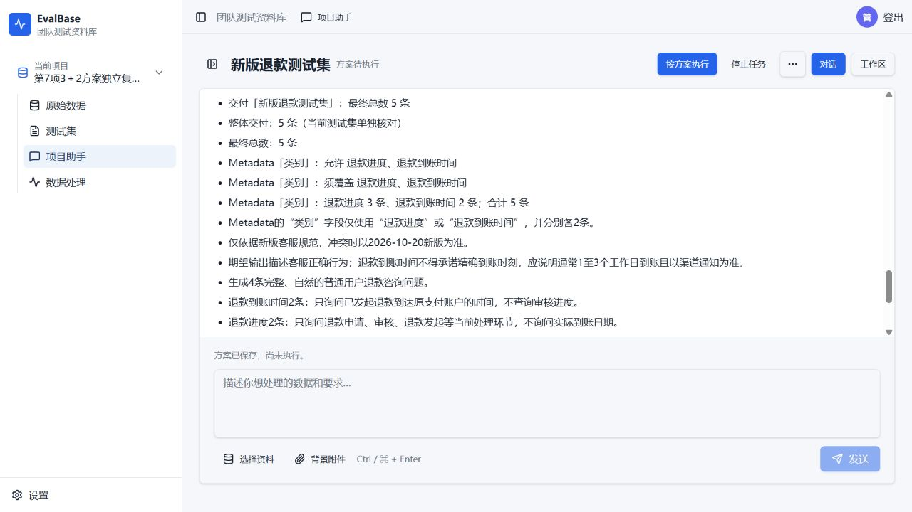

# 第7项独立Computer Use复测（2026-10-23）

结论：**部分通过，不能签完整通过**。3＋2数量修改已实际保存并刷新验证，但当前自然语言要求及生成步骤instructions仍残留2＋2／总4条，存在执行约束冲突。

固定4217应用版本：f8aef0aee8855c034a424ac3cead84018400ae10；模型qwen-new revision 2不变。项目project_b0c4a295cc054285bcbb24b84ecb3cf5，唯一新会话conversation_6414d351759149da93e617563133b3fe。本轮只测试第7项，没有修改业务代码、重跑其他项或重开旧预算。

| 检查 | 结果 |
| --- | --- |
| 两份新版／旧版规范上传 | 成功；使用现有合成材料，新版优先 |
| 退款进度、退款到账时间各2条，先保存不生成 | 成功；真实结构化2＋2，总4；依据新版1至3工作日 |
| 重复要求类别名不变 | 成功；真实不变核对，方案不执行 |
| 退款进度改3，另一类不变 | 数量已保存：targetCount、overallTargetCount及生成步骤outputCount均5；分类quotas为3＋2；同一deliveryId保留 |
| 旧数量要求是否消除 | **失败**：当前requirements仍为各2条、生成4条、退款进度2条；生成步骤instructions仍要求总4、2＋2。刷新后仍在 |
| 运行报错／自动纠正／恢复 | 3回合均succeeded，工具失败0；自动纠正0、手动继续0、超时0、临时限额拦截0 |
| 真实产出 | 处理运行0、草稿0、采用提议0、生成0、发布0 |

实际6次模型请求，HTTP活动15492ms，限额24次／240000ms，单次最多60000ms；本轮已关闭。外层门禁准备与UI文件选择定位期间没有模型请求，未影响本轮统计。

## 直接证据与问题边界

修改时模型第二次plan_task仅提交deliveries的id、count=5和classifications=3＋2，未同时提供requirements和instructions的新版本；服务端保留旧文本后仍给出“方案已保存，尚未执行”的成功结果。当前既有数量更新机制没有让结构化数量与已存执行文案一起保持一致，也没有阻止这次冲突保存。此轮未执行生成，不能声称已经导致错误生成，也不能将其视为纯页面显示问题；旧文字存在于executionPlan.steps[0].input.instructions中。

[初始真实方案](initial-plan.json)、[重复要求核对](unchanged-plan.json)、[修改后方案](modified-plan.json)、[刷新后方案](refreshed-plan.json)、[工具输入与回执摘要](turn-audit.json)、[结构化结论](result.json)、[已关闭预算](campaign/budget.json)、[执行前计划](plan.md)。初始2＋2历史消息和快照保持，未用技术提示或新会话凑通过。

18类旧业务表原行全部保留，30份旧预算SHA保持，包括上一轮已通过的第10项账本。数据库私有备份和逐行指纹仅存服务器，不纳入提交。临时门禁收尾移除，4217仍运行原f8aef0a应用。应用未合并／推送。
