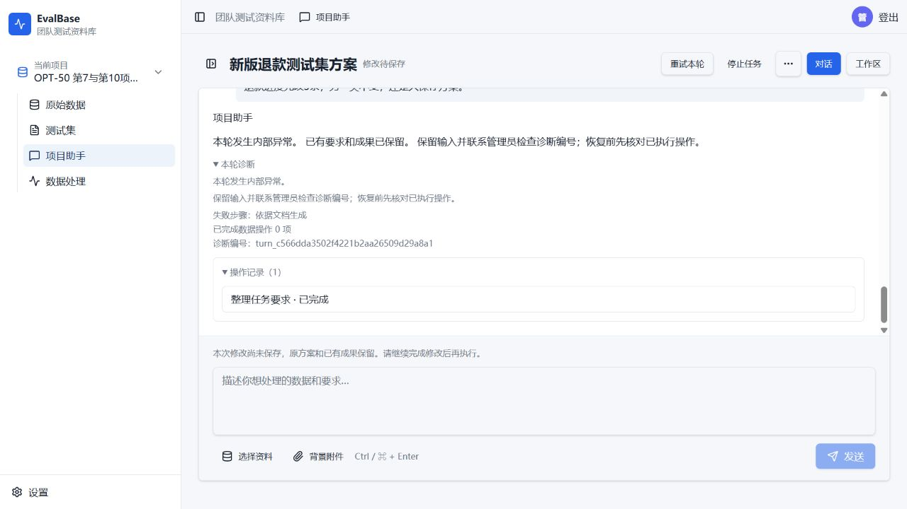
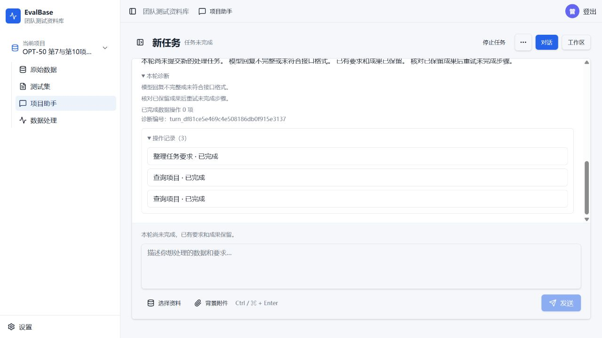
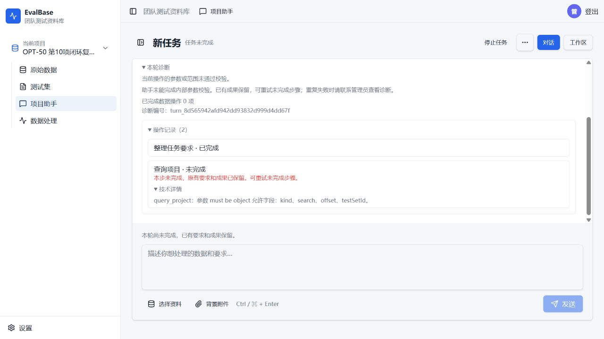
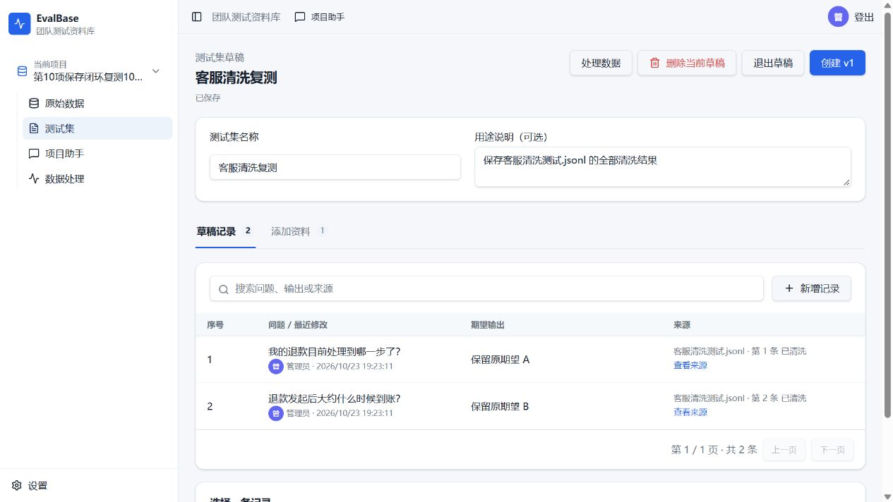

# OPT-50 续接交互：开发、定向验证与4217有限验收

日期：2026-10-23。服务器工作树 /home/bistu/EvalBase/.worktrees/agent-data-processing，分支 codex/assistant-optimization。初次实现代码 **be2b8b1ff7e1edbddce2cfe95617dd10908fd5ba**，基线eabfc32；后续第10项补修与最新部署见文末。

## 当前结论

最新4217应用代码 **f8aef0aee8855c034a424ac3cead84018400ae10**。**第10项已通过完整Computer Use闭环**：同一独立新会话、4条普通提示，发现真实资料并澄清来源，清洗2条，原确认卡保存成一个独立新草稿，打开并刷新验证2条。实际12次模型请求、73935ms HTTP活动，未手动继续，零生成、零发布。清洗配置和采用选择各出现一次参数错误，均自动纠正；不能表述为模型从未出错。

最终107项定向回归全通过（66单元＋41公开业务集成），静态检查及固定版本构建通过。18类旧业务表全部原行保留，29份旧预算文件不变；本轮预算已关闭、临时门禁已移除，4217恢复正常使用。过程中的历史失败及预算全部保留，详见文末。

**OPT-50整票仍为in-progress / Validation partial-pass / Owner pending**：本轮只完成CU10，未重跑CU7及其他已完成项；CU7已另开独立预算复测：3＋2数量保存成功，但旧2＋2生成说明仍残留，完整验收未通过。本轮成功不代表任意模型、长任务及所有场景均不会出错。

## 实现

- 工作卡、提交错误和按钮消费服务端feedback、taskId、budget及offer；不在前端重算额度或按旧错误码猜当前任务状态。旧消息迟到不影响当前成功和输入。
- 继续/修复额度复用原Dialog与按钮；展示实际目标、待保存请求和持久未完成步骤，明确purpose、单段上限及已用量。只有确认才提交offerId/当前修订/用途/accept，不能填任意数字；失败、到期、并发冲突重新读取能力，保留输入。
- 历史任务按需只读读取；原确认卡归原任务。选择恢复后仅填入可见请求，用户发送才恢复。现有消息入口增加受修订/会话/权限/幂等保护的restoreTaskId选择器，精确恢复同名历史任务；禁止混入context/candidates/operation。没有新工具、框架或执行权限。
- 首次页面水合不误清待重试幂等键；真正同会话任务切换才清任务绑定。长弹层限制视口高度，正文独立滚动，按钮区可键盘操作。frontend-v1 donor未改。

服务端continuation只展示实际失败请求及存储步骤，SQL绑定当前session/task；不根据聊天措辞重新猜范围或额度。采用/发布固定确认边界保持。

## 定向验证

| 验证 | 实际结果 |
| --- | --- |
| [scope-final](opt50-development-20261023/scope-final.json)：公开预算/状态14、反馈24、工作区6 | 44通过、0失败 |
| [restore-green](opt50-development-20261023/restore-green.json)：真实HTTP/数据库同名任务精确恢复 | 1通过；未知目标404、缺修订/混参数422、旧修订409、同键回放只一次 |
| [ui-final](opt50-development-20261023/ui-final.json)：控后端浏览器页面 | 13通过、0失败/跳过；38秒内完成 |
| 后端/前端TypeScript，受影响文件ESLint及差异检查 | 通过；前端原effect的一项依赖warning未扩大修复 |
| 固定git archive构建及镜像代码标签 | 通过；依赖/锁文件/Dockerfile未改，复用既有固定基础镜像 |

13项页面覆盖显式用途及额度确认、双击/两标签冲突、过期、409保留输入、历史确认禁用、迟到旧回合、已完成不被旧错盖、跨3段轮询、初始水合幂等、精确恢复以及480px/长内容键盘。控后端不访问真实模型/验收库。45项后端/单元使用专属UUID库、本地脚本模型和隔离测试桶。

原始红灯及过程失败保留：scope-red暴露真实待保存请求缺投影；restore-red暴露入口不识别选择器；ui-baseline-red暴露缺额度/修复入口及旧确认未禁用。水合回归的初版夹具错用localStorage，纠正为sessionStorage后通过；其基线再测未复现红灯，不能宣称所有新增断言都已证明旧版失败。Vite共享cache权限、漏project-access模拟、presence误计POST、容器runner挂起、主机字体/动态库缺失均为基础设施或夹具问题，未计为业务失败。后改用独立cache及目录内解包字体/依赖，不改系统包或重启Docker守护进程。

Standards/Spec分开审阅。水合误清键、长Dialog遮按钮及同名恢复不精确三项已补修；最终仅窄复核变更，均无剩余发现。独立代理只审代码，测试由主代理运行，不代签真实CU或Owner验收。

## 全链路与工具覆盖

[统一索引](opt50-development-20261023/coverage-index.md)关联F01～F12、TP01～TP08、15工具/90顶层字段及原399条复用路径。按实际声明、直接/计划/纠错/恢复/确认入口逐项追溯，正负例复用46～49公共流程族；没有把字段数量写成测试通过数。原177/247/170/170各自证据有重叠，不相加，也未重跑真实已完成验收。

由于CU10实际纠错/澄清链失败，R50-5与R50-8/9整体验收不能关闭；静态接线和受控正确结果不足以证明普通开放模型完整业务终点。来源/容量/范围等其他组合仅按已列控制夹具负责，不声称任意模型零错误。

## 4217部署与保护

- 只更新web、model-worker为evalbase-agent-checkpoint:be2b8b1ff7e1；worker仍94177609b4eb，postgres/minio及worker容器身份、卷/网络保持。health、ready及实际JS资产200，代码标签一致。
- 切换前无活动turn/job，已备份数据库与旧env（私有0600，不提交）。18类业务表按旧列逐行指纹保护，兼容新增task_id列，不清空/迁移旧任务额度。部署后旧行逐值相等，验收后原行全部仍在；22份旧预算文件SHA不变。
- 原无关dirty semantic-results.json SHA256仍c99545cc5a5af148cbc194935cf8973fff6260829435b9f717903f1db2f52a0c；未触碰、回滚或纳入提交。
- 本机4217环回SSH隧道已恢复；没有公开暴露端口。使用已有验收账号，无新账号/密码变更。

## 真实Computer Use：仅一个新合成项目、两个独立新会话

模型设置revision 2、qwen-new，沿原endpoint/key；不改变模型配置。项目project_3a3ebb3a84bb4c88a31cba295295d7c5。材料/普通提示和执行前限额见[plan](opt50-development-20261023/campaign/plan.json)。所有上传、提示与页面动作由侧栏浏览器实际完成；SQL只读核对，不补造业务结果。

每项最多24实际外发/240000ms活跃，两项48/480000ms；更紧产品限制保持。只允许各一次普通继续，不靠追加授权、内部参数提示或新会话凑通过。实际外发包括纠错/重试，未返回也计；临时门禁落账后才fetch，正文/等待一并计时，不记录密钥/请求正文。

| 项目 | 实际终点 | 外发/活跃 | 判定 |
| --- | --- | --- | --- |
| CU7 conversation_9ac6df2de942478298b83e0933498d35 | 上传新旧规范；初始2+2保存、新版1～3工作日依据及两类别正确；重复要求真实verified；3+2未保存，一次普通继续409 | 5次；实际HTTP11808ms，任务活跃13140ms；产品账6次含本地门禁拒绝，不清零 | **测试设施失效，未完成** |
| CU10 conversation_1ddb87da7a79440badd72e243164f5b4 | 两份可见JSONL已上传并映射，目标仅2条问题有空白；首次查询失败；普通继续查到drafts/files仍未收束成来源问题，未提交清洗 | 13次；HTTP46786ms，任务活跃49878ms | **真实流程失败** |

总18次外发、活跃63018ms；均未超限。处理运行0、生成0、采用0、新草稿0、发布0。合成原始4条/目标2条内容、映射及原文件hash不变。账本已closed=true，两项均关闭；原旧预算不修改。临时门禁随后从web/model-worker移除，服务恢复原启动参数、同代码健康。

### CU7测试设施错误（不能归因模型）

初版临时门禁用message.operation!=clean阻止所有其他operation，误伤合法规划载荷amend_plan。在模型fetch之前抛异常；业务诊断显示application/internal_error、httpStatus空且4ms，外发账本无该请求，源码plan-request.ts对应operation可确认。初始2+2及核对5次均HTTP200，无模型超时证据。

按约定一次普通“继续保存方案，先不要执行”被409 assistant_retry_unavailable拒绝，输入保留。不能把此恢复拒绝单独当作自然模型失败的证明，因为前置异常由测试门禁制造。保留[初版门禁](opt50-development-20261023/campaign/gate-initial.mjs)、修正后门禁和首错截图。后将禁操作约束收窄到真实processing run，仅用于未开始的CU10；**未重开CU7或重置其预算**。CU7最终3+2刷新仍2+2，真实修改终点需要之后单独授权重验。

### CU10真实问题及需承接事项

1. 首次query_project参数kind=project同时带offset=0/search=数据，被实际条件合同拒绝assistant_tool_input_invalid；后出现assistant_no_progress，未给出具体文件澄清。不是HTTP失败：所有实际请求返回200。
2. 一次普通继续后查询drafts/files成功，但最终assistant_result_incomplete；没有保存具体来源澄清/范围，无清洗回执。当前任务assistanttask_ce814b0f887141619fa91e5e5ea341d8。
3. 本轮首错、一次恢复以及诊断完整保留在[cu-proof](opt50-development-20261023/cu-proof.json)和[关闭账本](opt50-development-20261023/campaign/budget.json)。最终回合repairRequestsUsed=0；不能称为两次参数纠错成功、自动恢复通过或额度耗尽导致。最终10步上限是有界停止事实，不是业务交付完成。
4. 回到所属机制（OPT47发现/条件合同、OPT46/49纠错与恢复）复核：模型声明与执行分支条件是否一致；合法发现结果能否持久收束为一次具体业务来源问题；拒绝参数后的恢复是否推进真实澄清而非重复控制/解释。补充真实坏参数→普通继续→files返回两份资料→持久澄清的公共回归，不扩大token/循环或靠技术提示补范围。本票不另造一套工作流。

## 仍未通过与交付边界

- CU7最终3+2以及CU10固定2条→清洗→审核→确认保存均未通过。没有清洗结果，无法签清洗后字段保护和确认回执的真实CU终点；只能复用原受控证据。
- 未调用真实追加授权，追加/并发/修复用途只在可控测试验证；没有烧真实长对话、性能压测、内容质量验证或重跑旧248/400条。
- 当前代码和回归可审阅，真实失败仍在4217可查看。整票不关闭；不合并main、不推送、不打tag。后续更改和新真实验收须沿记录承接，不修改本轮关闭预算或改签历史。

## 2026-10-23 第10项查询与来源澄清补修

### 修复与验证

基线9b2de35，代码 **b035e767cabbe06d501a8e22692c510f5299c0ec**。修复范围：

1. query_project按kind共享字段合同，接入直接模型声明、计划内嵌声明、最终校验和纠错，不再由模型声明允许project+search/offset而业务拒绝。
2. 已有业务参数纠错优先于普通查询/执行提示，实际请求带最新原提议与错误；避免消耗纠错额度却发送普通查询提示。
3. 首次查询未形成sourceDiscovery时，普通继续沿原任务需求发现资料；明确名称也保留。有歧义立即持久化来源问题；真实选择及范围明确后才清洗。继续未回答的同一来源问题沿原纠错身份，额度不能重置。
4. assistant_result_incomplete本身不再作为模型协议错误证据；真实SDK协议错误和length证据仍分类为模型问题，历史诊断保留。成功来源澄清清除当前旧失败。

未新增公开API、数据表、业务权限或更高预算；frontend-v1与前端源码未修改。Standards最终0项；Spec发现计划嵌套声明漏接1项，已补回归并窄复核通过。审阅提示的连续继续身份及明确文件名恢复边界也经先红后绿闭合。

受控结果：[99项去重汇总](opt50-case10-repair-20261023/targeted-summary.json)。包含真实HTTP/数据库首错→继续→同身份累计纠错1→2→2→明确来源→一项真实两条清洗；字段保护、权限、范围冻结、已有处理预检、预算账本及纠错运行时。使用独立UUID测试库、测试桶、脚本模型；没有重跑其他真实完成项。类型、变更文件lint、固定git archive构建通过。新增根因断言先红；中文上传夹具补percent-utf8头以匹配真实前端，结果记录断言核对result字段。

原错误定位补充：旧CU10首轮实际有1次失败纠错，下一轮是0次；不把最终回合0次误写为整个会话未纠错。

### 独立Computer Use复测（未通过）

计划与预算在执行前登记于[本次计划](opt50-case10-repair-20261023/campaign/plan.json)。仅CU10，一个新会话，24次实际请求/240000ms活跃上限，仅允许清洗2条、一个新草稿、零生成/发布。来源材料通过侧栏浏览器上传映射；使用普通提示，不提供工具参数或ID。

- 项目：project_2d73b0e1ce5241d4b0585559b03adb65。
- 会话：conversation_c92486b8b2e449f69371857640895076；任务：assistanttask_8d0b8d39886848cfb42db379908ebc7c。
- 首句：帮我整理一下这些数据。
- 首错：query_project参数未通过根对象校验（must be object，assistant_tool_input_invalid）。两次实际自动纠正都无效，outcome=exhausted；4次外发全部HTTP200，无timeout/length证据。
- 实际4/24请求，14812/240000ms任务活跃；同因纠错耗尽触发既定停止条件，未使用技术提示/普通继续/换会话/追加授权。
- 结果：0清洗运行、0草稿、0采用、0发布；两份合成材料4条原文、映射和文件hash不变。来源澄清与后续清洗保存终点本次均未到达，不能签通过。
- 本次错误证据仅能确认“根参数对象校验和两次纠错失败”；原始provider工具参数正文未持久化，不能把具体非对象内容或Schema兼容性猜测写成已定位根因。下一步应在受控边界补齐根参数形态和SDK解析/格式纠错的原始证据，先离线定位，不能靠加额度掩盖。

[完整脱敏观察](opt50-case10-repair-20261023/cu-proof.json)、[已关闭新账本](opt50-case10-repair-20261023/campaign/budget.json)。

### 4217与保护收尾

web/model-worker固定b035e767cabbe06d501a8e22692c510f5299c0ec；普通worker、PostgreSQL、MinIO及卷网络保持。health/ready/实际JS资产通过。部署前备份，18表旧行及23份旧预算（含已关闭的原OPT50账本）指纹全部保持；无关semantic-results.json仍为原SHA。本次账本closed=true，临时请求护栏已卸载，4217同代码健康。未合并main、推送或打tag。

整票仍in-progress/partial-pass；CU7未重跑，其既有测试设施失效结论保持。此次完成机制补修与一次限额复测，不等于全部真实链路成功。

## 2026-10-23 第10项持续定位、修复与最终闭环

按Owner“修复至通过第10项”授权逐轮处理真实阻塞，每次版本变化另建独立有上限campaign；不重开旧账本、不在失败会话重置计数，不重跑其他测试项。每轮允许的最大范围始终为24请求／240秒、2条清洗、1个新草稿，生成和发布均为0。旧失败仍按失败保留。

### 机制修复

| 根因 | 修改及边界 |
| --- | --- |
| query_project根参数非对象时根路径未统一，纠错也无法重建 | 720f1e4统一根路径问题，在只读查询中允许重建无有效字段的坏根；有意义字段继续保护，仍共用原两次纠错限额。 |
| 模型对查询条件Schema的约束表现不稳定 | 1fcf51b把条件Schema改为等价显式anyOf分支；服务端校验没有放宽。保留同模型小规模对照证据，不能仅归因模型随机性。 |
| 文件名澄清后丢失已确认来源／范围；泛指请求绕过发现 | a8847bd、908a86b让持久来源确认与范围授权分别处理；无来源的处理请求先走已有有界发现，不重复跨kind扫描；文件名不自动授权全部。 |
| 清洗默认要求与范围续接不同入口不一致，恢复可能重建额外运行 | c4789df统一采用编译后的参数，只对可证明等价的首尾空白要求归一；保留字段变更、子集排除和来源计数保护；新的范围澄清清除旧全量授权，恢复按回执复用原运行。 |
| 保存候选时混用文件／结果ID、空勾选或多范围参数，业务错误缺少可修复字段路径 | f8aef0a为采用入口返回真实当前批次及结果位置，纠错明确指向结果集合；逐错误索引只准修复坏ID，保留正确ID、目标、数量和未出错批次；重复ID只能去重，不能换入额外记录。原确认、权限、修订和幂等边界不变。 |

未新建工作流、公开API或数据表，未改frontend-v1 donor。e22b2d0仅修正不符合现行任务／上下文合同的旧意图测试夹具，未放宽业务校验。

### 定向验证与审阅

- 最终[tests-final](opt50-case10-adoption-repair-20261023/tests-final.json)：107通过、0失败、0跳过。包含真实清洗受理、完成后候选核对、未知结果ID／混合范围／未知批次的自动修复、确认前零草稿、确认后只生成一个2条草稿，以及不扩大有效记录集合的反例。
- [范围发布回归](opt50-case10-scope-repair-20261023/release-suite.json)75通过；[发现路由回归](opt50-case10-discovery-routing-20261023/green.json)78通过。与最终107存在重叠，不相加为唯一用例数。清洗恢复红灯及修复回归保留原报告，最终107再次覆盖这些公开处理路径。
- 后端TypeScript、受影响文件ESLint、git diff --check通过；从固定git archive构建，镜像标签与部署SHA相同。未重跑全库或真实已完成部分。
- Standards／Spec审阅中发现“修坏ID时可能替换有效ID”和“重复ID借修复增加记录”边界，已按索引补齐保护和正反例，复核无剩余必要修改。
- 过程测试的payload/receipt字段、重复上传文件名和确认后自动续步泄漏属于夹具问题，已按真实合同修正；初始失败报告保留。审阅及自动回归不代替以下真实CU终点。

### 真实Computer Use最终结果

代码f8aef0aee8855c034a424ac3cead84018400ae10；模型qwen-new，现有revision 2、endpoint/key未改。[执行前计划](opt50-case10-adoption-repair-20261023/plan.md)、[关闭预算](opt50-case10-adoption-repair-20261023/campaign/budget.json)、[实际回执](opt50-case10-adoption-repair-20261023/cu-result.json)。

- 项目：project_2f5c0f28a9664a51bbb6f4485958c854；会话：conversation_5fe0eddc6ce6453fad825ae0182666e2。
- 普通提示依次为“帮我整理一下这些数据”→“客服清洗测试.jsonl”→“清洗这份文件的全部2条记录，其他不改。”→“保存为新的测试集草稿，叫客服清洗复测。”；仅通过UI上传／选择／输入／确认，未用脚本补业务数据。
- 初次泛指请求真实列出两份文件；选择文件后确认对象，接着按用户全量2条范围提交。只建立processing_77cd0c8379db4cf0be9e7dc8d097b9d0一项clean运行。
- 第3条提示中metadataKeys误填顶层question，第一次自动纠正去掉无授权Metadata改动和不适用数量，并使用已授权全量来源；实际question仅trim，期望输出与Metadata逐值保持。
- 保存请求误带无UI勾选的allSelected，第一次自动纠正删除该冲突标志，保留原allTask、目标和批次；原确认卡显示新草稿＋2条，点击确认才产生采用回执，未自动越过确认。
- 最终草稿collabdraft_8a344dfd2d304e7897bf8da23060c93b“客服清洗复测”，2条记录；网页打开并刷新核对。6回合全部succeeded，2项唯一工具错误均自动修复；自动续步中的历史错误回放不重复计为新错误。
- 实际12请求／24上限，73935ms HTTP活动／240000ms上限，手动继续0次、技术提示0条；新草稿1、清洗运行1、生成0、发布0。两次内部参数错误未导致本轮任务失败，不能称为零错误运行。

### 历史失败与数据保护

本轮之前的根参数、Schema、范围、发现路由和清洗／保存失败仍保留在各自关闭campaign及诊断记录中。c4789df轮次曾因测试门禁会话映射写反，在外发0次时失败；更正未消费的新门禁后用普通继续恢复，之后清洗成功但采用失败，仍记该轮未通过，未把它改签成功。

最终18类业务表旧行全部保留、29份旧预算SHA不变；本次两份原始文件4条记录及hash／映射前后相等。业务保存按既有合同新增一个清洗产物文件，不属于改写原始文件。数据库备份及逐行指纹仅私有保存在服务器，不提交敏感证据。

4217 web／model-worker更新到f8aef0aee8855c034a424ac3cead84018400ae10；worker、postgres、minio及数据卷保持。最终campaign封存后移除临时外发门禁，健康检查仍为同一SHA。原无关semantic-results.json未更改、未纳入提交；未合并main、未推送、未打tag。

## 2026-10-23 第7项独立复测补充

[本轮唯一记录](opt50-case7-retest-20261023/report.md)：应用f8aef0a，唯一新会话，普通3条提示完成初始2＋2、不变核对和3＋2数量真实保存，刷新仍为5条；但requirements及生成步骤instructions残留总4条／2＋2，**不能签完整通过**。6请求／15492ms，工具错误0、自动纠正0、恢复0、生成0。新预算关闭，30份旧预算与18类旧表原行保持；临时门禁移除。CU10原通过结论保持，整票仍in-progress／partial-pass／Owner pending。未修改业务代码。
