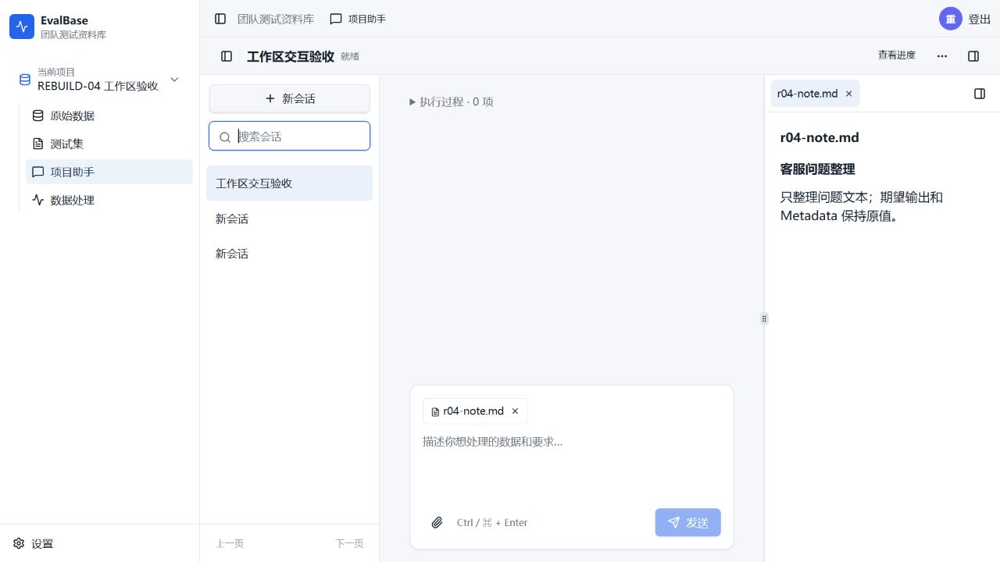

# REBUILD-04 实施与定向验证记录

- 日期：2026-10-28；分支：`codex/assistant-rebuild`。
- 实施基线：`8ab68edf896284c1e63f4a21cdd88d58014c64c5`；主体实现：`3ab4e13df09f021b58a95b4774c208474cfc8753`；协议修复：`ada7cf71cf0ddb00a75666f1912b464925e74b51`；第三轮参数纠错修复：`c63943e9829d070205146cfb9a2d12d008a342b8`；完整合同修复：`646ab8b64a00b0e1c7546737c78cf9cc2d749e44`；依赖加工规则修复：`f2e5f2056540d0c8743ce393cec9d3f647579cff`；身份合同修复并用于第六轮CU：`483f35e94eba53537ba38acfa9c45d6296d0e6b6`；后续等值字段补强及当前隔离预览：`3fd1a5f`。
- 当前结论：身份合同修复及第六轮实模已完成记录；C01未重复新增交付，但因纠正补写同值active状态被拒而失败，已另行补齐有效继承值比较与组合保护。最终受控验证144项通过；补强后未再运行实模，**R04-6未全闭合，本票保持in-progress/partial-pass**。C02沿用第四轮通过结果，未重跑。详见[最新记录](#r04-identity-round6)。
- 合同：[票据](issues/04-assistant-workspace-and-action-bridge.md)、[Spec](spec.md)、[架构](../../docs/architecture/assistant-rebuild.md)。

## 实现与范围

frontend-v3 正式助手保留项目壳及导航，内部设置会话栏、消息区、输入框和按真实对象打开的工作区。会话创建、搜索、分页、改名使用本人/项目私有服务端状态；附件支持 txt/md/pdf，经公共提取器生成私有文档引用。关闭标签只关闭视图，最后一个关闭后仍能打开空工作区；没有原型 Mock 导出、假模型列表或第二套会话服务。

`@assistant-ui/react@0.15.31`（MIT；支持实际 React 19）仅使用 ExternalStore 展示适配，消息和业务执行仍以正式宿主为准，不使用 AssistantCloud。安装为统一重复的 Radix 依赖更新了锁文件中的 44 个同族包；未升级无关库。共享 Dialog、Sheet、草稿入口及420px窄屏已列入真实浏览器回归，不能仅以 npm 安装成功判断兼容。

认证 SSE 从持久快照投影消息、执行、操作、确认和回执；实际供应方公开正文流才显示正文，不输出内部请求参数、摘要或虚构推理。断流重连依靠稳定身份与快照去重，最终消息替换流中消息。连接持续校验登录有效期/撤销和项目访问。客户端仅保留输入、提交信封和视图状态，不另算业务进展或自动发“继续”。

消息提交保留原标识、载荷、上下文修订和附件集合，受理响应丢失沿同一身份核对；确认后若用户已输入新文字，不清除新输入。所有异步回写验证项目/用户、会话及切换代次，覆盖 A→B→A，旧 finally 不解锁新会话。接受快照可结束挂起的 HTTP 传输，但不取消服务器业务。双标签旧修订冲突保留输入。

页面桥复用草稿已有保存队列；从草稿进入助手先 flush，失败保留输入并停留。界面勾选范围携带原上下文修订，服务端按实际输入核对。凭据仍用原生设置表单，只有授权引用/非敏感回执进入助手；固定确认仅由用户控制 API 执行。

本票只把已有正式服务接成 C01/C02 所需的有限纵向能力：单份清洗/改写、固定输入和保护字段、真实处理完成等待、固定采用确认、新草稿与唯一保存回执。无参数提交/等待工具读取已保存的权威要求，不让模型重造冻结参数。暂停查询保留原回合检查点和账本，查询完成恢复原暂停事实；继续沿原回合推进。暂停查询在途也不能启动原 Worker。不是完整资料管理、扩充/从零生成、多交付、删除或发布工具；这些仍归后续票。

## frontend-v1 对照

| 区域 | 正式实现与验证 |
| --- | --- |
| 项目壳 | 沿用现有 Sidebar、项目导航、顶栏和权限；frontend-v1 donor 未改动。 |
| 视觉 | 沿用现有字体、蓝色主动作、浅灰背景、白色卡片、边框/圆角及 Lucide/Radix 组件；未引入桌面版独立色板。 |
| 会话栏 | 创建/搜索/分页/改名；可独立折叠，窄屏 Sheet。 |
| 消息/过程 | 普通方案、真实操作过程、固定确认和真实回执在消息区；流与快照统一身份。 |
| 工作区 | 按文档/处理结果/草稿真实身份动态开标签、重复定位及关闭；空入口始终可用，Metadata 展示真实字段。 |
| 动作桥 | 原生文件选择/文档上传、原生设置入口、授权下载、草稿 flush 和选择交接；不存在假保存。 |

## 定向验证

| 检查 | 最终结果与边界 |
| --- | --- |
| 后端/真实 SDK 受控服务 | `rebuild-session.test.ts`35项、`rebuild-execution.test.ts`41项、`rebuild-model-stream.test.ts`3项，**79/79通过**；使用实际 SDK、HTTP、数据库及 Worker，供应方为本地受控服务，外部模型请求0。 |
| 前端 | `formal-assistant.test.ts`与`assistant-page-bridge.test.ts`共**6/6通过**；状态、提交信封、对象身份及保存交接。 |
| 故障浏览器 | 真实 Web + 受控 SDK + Chromium：受理后响应丢失、保留后来输入、刷新核对、SSE断流重连、双标签修订冲突、迟到确认切会话、草稿 flush 后进入助手、420px Sheet/键盘关闭；数据库核对仅一消息/执行/业务回执。计入41项，不另加到85项总数。 |
| 安全与暂停 | SSE登录撤销关闭、跨账号私有性、输入修订核对、暂停后普通查询/继续、查询在途Worker禁止新增请求等均由上述集成覆盖。 |
| 静态与构建 | 根目录及 frontend-v3 类型检查、受影响 ESLint、正式前端构建和服务端编译通过；前端全量 lint 仅3项既有 warning，无新增error。 |
| Computer Use 无模型交互 | 4240：实际私有新会话/附件上传与预览、重复开标签、最后标签关闭、空入口、附件移除重传、会话改名与搜索、导航/会话栏折叠；未发模型请求，不冒充 C01/C02。窄屏/时序故障用上列真实浏览器自动回归。 |
| 审阅 | Standards 与 Spec 两路独立审阅发现的问题已逐项修复复审；新增 System 排序修复也分别定向复审无新发现。 |

运行日志保存在服务器 `.scratch/assistant-rebuild/r04-verification/`：`closing-regressions.log`（修复前78项）、`closing-front.log`、`static-final.log`、`system-order-red.log`、`system-order-final.log`（最终79项）及`preview-update2.log`。浏览器缺少共享库/字体、测试Origin夹具与请求基数断言等首次失败记录保留；未用删测方式绕过。首次预览构建因隔离工具链无 npm 可执行入口失败，改为显式调用同一 npm CLI 和 tsc 后构建成功；不涉及业务或模型重跑。

## C01/C02 实际结果与封存

环境为新数据库 `evalbase_r04_20261028`、新bucket `evalbase-r04-20261028`、4240预览，共用测试基础设施的独立命名空间。仅加入合成的6条客服问题和专用测试账号。已有数据、旧活动账本、4217及正式环境未修改；未合并main、未推送。

| 用例 | 普通提示与实际情况 | 实耗/上限 | 结果 |
| --- | --- | --- | --- |
| C01 | “先给我前5条的清洗方案，不执行。”；会话`assistant_6a968d6d7fe846c985fb998f272f33aa`；首次HTTP400，未提交后续“改成前3条…”要求，无工具/处理作业/草稿。 | 请求1/18，处理行次0/9，生成槽位0；单项25分钟。 | 失败；活动`r04-20261028-C01`已封存。 |
| C02 | “把前3条问法改自然，标签和Metadata别改，保存成自然问法。”；会话`assistant_ff529704640e4b43a7265b2f40d8224d`；首次HTTP400，无工具/处理作业/草稿。 | 请求1/18，处理行次0/9，生成槽位0；单项25分钟。 | 失败；活动`r04-20261028-C02`已封存。 |

合计实耗2/36次请求、0/18处理行次、0生成槽位。供应方未返回usage，token消耗记为未知，不能写0。活动开始及封存时间均在[原始账本](r04-evidence/C01-ledger.json)、[C02账本](r04-evidence/C02-ledger.json)。按首次失败停止，不重置旧活动、借额度或自动新开实模验收。

C01首次直接拒绝没有保存供应方原始错误体。C02使用仅透传实际请求/模型/鉴权的本地诊断代理，捕获[供应方错误](r04-evidence/C02-provider-rejection.json)：`System message must be at the beginning.`，与同一共享入口相关。该代理原拟在真实Worker已完成响应后延迟15秒交付，以确保执行中暂停可观察；由于助手首请求已经失败，**延迟窗口未触发，未覆盖真实执行中暂停**，不得写成时序通过。代理现已停止，隔离模型配置恢复原qwen-new端点；没有另发连接测试请求。

## 根因、修复与剩余门槛

旧 middleware 把“当前服务端事实”作为末尾 System 消息追加。真实 qwen-new 的模板要求 System 位于开头，因而首次请求400；先前本地受控供应方接受这种错误顺序，这是 SDK 兼容回归的缺口，不是业务工具失败或预算不足。

修复将原系统说明、框架注入及当前事实合成一条前置 System（当前权威事实最后），保留 user/assistant/tool 时间顺序和结构化内容。供应方拒绝单独归因`provider_rejected`，失败页不再误称暂停。受控供应方补同样的拒绝规则；临时只还原3ab的反馈文件能复现同一400（红测），恢复修复后79项通过。新增断言检查实际 SDK wire 上唯一前置 System、当前事实、工具先后及摘要后的当前数量。这证明协议修复的受控有效性，**尚未证明修复后的真实模型闭环通过**。

剩余必须在另行授权的新有上限活动中验证 C01要求修改/执行/确认/打开刷新，以及C02真实执行中暂停→查询→跨旧时限等待→继续→唯一保存/打开刷新；不能复用本轮封存活动或重跑旧已通过项。R04-6保留未勾选，本票不能关闭。后续域能力仍按依赖顺序推进，不能凭本次小闭环宣称完整助手可用。

正式工作区截图（无模型交互会话）：

## 2026-10-28 另行授权的有界 Computer Use 复测（第二轮）

Owner另行授权：只复测C01/C02，每项一个独立新会话，保留全部旧活动/数据，不重跑其他已通过项。本轮电脑操作由创建参数明确为 **GPT-6.1 Terra / high** 的独立执行代理完成；被测应用模型仍是 **qwen-new**，未切为Terra。应用代码仍为`ada7cf7`（HEAD `164ef50`仅增加首轮证据文档），未修改业务代码或更新4217。

每项独立18次实际请求、9处理行次、0生成槽位、25分钟；两项总限36次/18行次/0生成/60分钟。新活动为`r04-20261028-retest2-C01`和`r04-20261028-retest2-C02`；旧`r04-20261028-C01/C02`保持原封存值，没有借用旧余额。预检固定模型/源文件/依赖锁/工具Schema及Web/Worker状态，见[冻结预检](r04-retest-20261028-02/preflight.json)。

| 项目 | 实际 Computer Use 过程 | 参数错误与自动纠正 | 结果 |
| --- | --- | --- | --- |
| C01 | 新会话`assistant_9b8b4b6b2dc645eb872f6b69ad555501`，带真实六条资料上下文；仅发送“先给我前5条的清洗方案，不执行。”，界面显示“本轮未完成”。未发送第二条修改执行提示。 | 首次`read_records`的`source`被校验为string而非object；系统发起1次自动纠正，随后以`correction_intent_changed`终止。 | **businessResult: failed**；未形成保存要求/业务操作/草稿；无技术提示或人工重试。 |
| C02 | 独立新会话`assistant_9b061356614f4db090da11918776d8ea`及同一真实来源；发送“把前3条问法改自然，标签和Metadata别改，保存成自然问法。”，界面在处理作业创建前即显示“本轮未完成”。 | 原始参数记录为`read_project`参数仅`{`，触发`invalid_json`；系统发起1次自动纠正，随后同样以`correction_intent_changed`终止。 | **businessResult: failed**；未进入Worker，不能算真实执行中暂停/查询/继续/唯一保存通过；无人工重试。 |

两项 **safetyResult: pass（保护性停止）**：达到不能自动继续的失败后即停止并封存，未靠脚本补要求/创建数据/保存、换模型、补内部参数或增额救场。保护性停止不等于业务通过。上述是应用持久错误记录，不足以仅凭`invalid_json`判断一定是供应方原始输出或SDK分片采集哪一方出错；这需要后续专项定位。本轮未扩大到修代码。

本轮4个HTTP尝试全部为200：每项1次正文＋1次纠正，**原System位置HTTP400未再出现**。实际共4/36请求、0/18处理行次、0生成槽位；usage合计15198 tokens（输入14871、输出327）。每项尚远低于请求/行次上限，终止原因为纠错意图保护，不能归因于额度不足。

| 项目 | 实际请求 | 处理行次 | 封存时间（UTC+8） | 原始证据 |
| --- | --- | --- | --- | --- |
| C01 | 2/18 | 0/9 | 2026-10-28 02:06:53 | [账本](r04-retest-20261028-02/C01-ledger.json)、[错误事件/当前要求](r04-retest-20261028-02/C01-failed.json)、[页面截图](r04-retest-20261028-02/C01-first-failure.jpg) |
| C02 | 2/18 | 0/9 | 2026-10-28 02:08:38 | [账本](r04-retest-20261028-02/C02-ledger.json)、[错误事件/当前要求](r04-retest-20261028-02/C02-failed.json)、[页面截图](r04-retest-20261028-02/C02-first-failure.jpg) |

C02按票据预置了一次最多15秒的“真实Provider响应后延迟交付”停止窗口，不改模型/鉴权/参数/结果。但本次只发生助手及纠正请求，[透传记录](r04-retest-20261028-02/C02-upstream.ndjson)均为`worker:false`，**没有Worker响应，窗口未触发**；没有在规划阶段假装完成暂停。透传代理已停止、隔离模型端点与key还原，无额外连接测试请求。

[最终核对](r04-retest-20261028-02/final-audit.json)确认原六条资料快照哈希和旧两项活动/实际请求哈希均未变，本轮业务操作数0，新的两项活动均已封存。既有验收环境、其他已通过项及其预算未重跑/重置。本轮预检脚本首次遇到日期对象不能直接canonical化、只读取证脚本首次查询了不存在的`finished_at`列，分别在取证脚本中规范化日期和去掉该列；没有修改产品、模型请求、数据或业务执行结果，首个设施错误日志保留。

**结论保持：R04-6未通过，整票in-progress。** 新发现的缺口是首次工具参数及其纠正被意图保护拒绝；本轮未覆盖C01修改要求后执行保存，也未覆盖C02真实在途暂停、暂停查询、跨旧时限继续和唯一保存。不能把此轮短失败记成完成了这些阶段，也不能重新打开本轮活动继续尝试。

## 2026-10-28 参数纠错机制修复及第三轮有界复测

Owner授权修复第二轮暴露的问题、必要结构调整、真实SDK回归和另行有界CU；基线`1ee4715`，代码`c63943e`。运行时、工具、权限和数据库结构未扩张；只更新隔离4240后端/Worker，前端资源沿用无改动的R04构建，4217及正式部署未更新。`/health`、`/health/ready`和Web均200，返回上述完整代码SHA。

### 本轮实现和定向证据

- 共享工具边界根据权威Schema解码对象/数组的合法JSON字符串；限制字符串长度和遍历深度，不补业务值、不更换来源/数量/目标。原始与纠正参数先做相同规范化；对象键顺序不冒充语义差异。缺失原值不再任意补入引用。
- 待纠正状态持久保存原工具、调用、可信原参数、错误路径及尝试数；纠正响应再次截断时不覆盖首个可信快照。模型纠错上下文明确原工具；实际SDK wire仅暴露该工具并使用具名tool_choice，成功后恢复正常工具集。未知原始写参数仍拒绝猜测执行。
- JSON完整性使用SDK消息保留的原始arguments，避免其部分JSON解析结果被当成完整输入；移除宿主/传输层重复参数拼装。`parameter_normalized`记录无损修复路径，`correction_rejected`区分工具变化、原参数不可验证及受保护字段变化，只记录差异路径。失败文案说明安全停止并保留已完成记录。
- 真实SDK受控供应方每次响应使用唯一消息ID，工具参数支持真实SSE分片；原先常量响应ID会把新AI覆盖到旧消息位置，遮蔽afterModel检查，是本轮修复的测试夹具缺口。

定向验证：`rebuild-session.test.ts`40项、`rebuild-execution.test.ts`41项、`rebuild-model-stream.test.ts`3项、`rebuild-tool-arguments.test.ts`2项，合计 **86/86通过**；外部模型请求0，数据库均为测试临时命名空间。覆盖编码来源、实际SDK纠错工具/上下文/强制选择和恢复、缺失来源不能补猜、类型错误→纠正截断→剩余纠正成功、未知写参数拒绝、保存/暂停/恢复/确认/唯一回执。根目录类型检查、受影响ESLint、后端编译通过。前端未改，不重复运行旧CU已通过项。日志在服务器`.scratch/assistant-rebuild/r04-verification/correction-*.log`。

红测及首次失败保留：新增3项SDK用例在旧边界失败；取证断言先修正事件列名sequence→id及System结构化文本读取；连续截断回归又暴露常量响应ID问题，修复后45项SDK/单元及41项执行检查通过。不能把受控供应方提供的正确响应称为实模纠错成功。

Standards/Spec双轴审阅发现缺失引用任意补值和纠正截断覆盖原快照两项问题，已修复并定向复审；最终复审未发现新的问题。该结论限当时差异，不覆盖下列随后CU发现的未关闭问题。

### 第三轮 Computer Use 实际结果

电脑操作代理明确使用 **gpt-6.1-terra / high**，IAB真实页面操作；应用模型仍为 **qwen-new**。仅两个独立新会话，不补技术提示/内部参数，不用脚本替代规划、处理或保存。[预检](r04-retest-20261028-03/preflight.json)固定代码、模型、六条原件和全部四项旧活动/请求哈希。

| 项目 | 新会话与活动 | 实际过程 | 结果/实耗 |
| --- | --- | --- | --- |
| C01 | assistant_73e2bb4dd1ac4612aedd13e2a12877bb；r04-20261028-retest3-C01 | 第一条“先给我前5条的清洗方案，不执行。”；source字符串已自动还原并实际读取5条。首次update_requirements交付字段平铺；自动纠正1次后被拒。未发第二条修改提示。 | **failed**；3/18请求，0/9行次；无已保存要求/作业/草稿。 |
| C02 | assistant_1fe961eb88044b339125dd666c0cc2f3；r04-20261028-retest3-C02 | 原提示改写前3条；读取项目/目录/资料成功，source字符串自动还原。首次update_requirements交付平铺；自动纠正1次后被拒。 | **failed**；5/18请求，0/9行次；未进入Worker，未执行停止/查询/继续/保存。 |

合计 **8/36实际请求、0/18处理行次、0生成槽位**；8个请求均HTTP200，usage合计37093 tokens。活动分别在UTC+8 02:53:10、02:56:01封存；未增额、重置或重新打开。

原始证据：[C01账本](r04-retest-20261028-03/C01-ledger.json)、[C01事件](r04-retest-20261028-03/C01-failed.json)、[C01纠正前后参数](r04-retest-20261028-03/C01-correction-calls.json)、[C01截图](r04-retest-20261028-03/C01-first-failure.png)；[C02账本](r04-retest-20261028-03/C02-ledger.json)、[C02事件](r04-retest-20261028-03/C02-failed.json)、[C02纠正前后参数](r04-retest-20261028-03/C02-correction-calls.json)、[C02截图](r04-retest-20261028-03/C02-first-failure.png)。

### 本轮新增的未关闭缺口

1. **交付包装结构的等价比较不足。** 两项首次都把name/count/source等字段直接放在deliveries元素，而正式合同要求位于patch。C01纠正仅将原值移入patch，业务值未变，当前保护仍把路径变化判为语义变化；JSON字符串解码已生效，但不覆盖这种包装结构转换。
2. **纠正遗漏原有效字段。** C02除了移入patch，还遗漏原changes.objective。不能通过取消意图保护直接放行，否则会丢要求。后续应基于权威Schema明确可证明保值的包装投影，并将纠正限制为修复原错误位置、保留未变有效字段；补组合SDK回归后再申请新的有界实模验证。本轮未为了救场临时放宽保护或更换模型。

C02按合同预置一次最多15秒真实Provider响应交付窗口，但[透传记录](r04-retest-20261028-03/C02-upstream.ndjson)全部worker:false，窗口未触发。没有捕获真实执行中暂停，**暂停→查询→超过60秒→继续→唯一保存仍未完成CU验收**。

[最终核对](r04-retest-20261028-03/final-audit.json)：原六条记录哈希不变、全部旧活动和请求哈希不变；新业务操作0。临时代理已停止，原模型端点/模型/key还原，无额外连接测试。依Spec“达到无进展/纠错/服务限制或需技术救援时保留首错并停止”，本轮不继续封存会话，也不自动追加第四轮。**R04-6继续未通过，整票in-progress/partial-pass。**

## 2026-10-28 完整参数合同修复及第四轮有界复测

Owner授权修复包装结构等价比较和纠正遗漏有效字段，并检查相邻组合；本次基线905f672、实现646ab8b。只更新独立4240后端和Worker，前端未改、沿用原R04正式资源；4217与正式部署、main/远程仓库均未更新。健康/就绪/Web返回200，运行后端SHA为646ab8b64a00b0e1c7546737c78cf9cc2d749e44。

### 实现及真实SDK回归

- 权威Schema驱动有界表示规范化：JSON字符串、声明的标量数组、无损整数、默认值和修剪；update_requirements只对已注册交付字段作平铺→patch投影，平铺与patch冲突直接拒绝。整数转换使用精确值核对，不能把3.0000000000000000001舍入成3后执行。
- 纠错依次执行“保留原有效字段→物化纠正遗漏字段→以完整上下文规范化→核对受保护值”。持久区分原始可信args和workingArgs，截断响应不覆盖已完成修复；保存Schema版本/hash，失配在调用模型/工具前停止。显式改变来源、数量、目标或原有效字段仍拒绝；没有原引用的写调用不猜测。纠正阶段不提前应用分页默认值覆盖旧值。
- 以readOnly能力处理截断的空只读调用，不再只特判read_project。整条多工具响应在执行前验证；未知字段的可删除路径保留，重复tool_call_id、并发要求写入、跨工具纠正等不产生部分副作用。业务冲突返回领域错误及有限提示，不进入无可修字段的参数循环。
- 处理提交冻结当前要求修订、objective、instructions和分类约束，数量/来源/字段范围在业务边界复检；Metadata可修改但键空数组的歧义拒绝，禁止修改时不把空键数组误传为写许可。确定性清洗在提交前核对预期输出，采用前再核对实际结果的分类/配额等结构约束；不新增模型语义评审或公开API/数据表。

本次唯一受影响用例计数：session真实SDK46项、execution集成44项、组合单元16项、原规范化2项和模型流3项，合计**111项通过**。105项回归组与后来新增只读进度SDK/清洗全链2项有重复，按唯一用例计数，不相加夸大。受控服务使用实际LangChain/Deep Agents SDK、HTTP分片、数据库/检查点/Worker；外部模型请求0。根目录tsc --noEmit、受影响ESLint及后端tsconfig.server编译通过；前端未改不重复构建/CU旧已通过项。

证据：[初始红测](r04-retest-20261028-04/targeted-red.log)、[105项回归](r04-retest-20261028-04/targeted-sdk.log)、[相邻SDK/清洗](r04-retest-20261028-04/targeted-adjacent.log)。首次红测7项机制失败保留；调试过程的夹具/断言错误和日志留在服务器contract-*.log，没有删失败改写为首跑全绿。Standards/Spec双轴审阅发现重复调用ID绕过、整数精度丢失、确定性清洗未消费冻结分类约束三项，均已修复及针对性复审，未发现新的可操作问题；该审阅不等于下列真实模型结果保证。

### 第四轮Computer Use与实际结果

电脑操作由**gpt-6.1-terra / high**独立代理控制侧栏浏览器，应用模型仍是qwen-new。每项独立新会话，限18实际请求/9处理行次/0生成槽位/25分钟；合计36/18/0/60分钟。冻结[预检](r04-retest-20261028-04/preflight.json)后执行；只跑C01/C02，未重跑其他已通过验收。

| 项目 | 普通提示与真实过程 | 参数错误及自动纠正 | 结果 |
| --- | --- | --- | --- |
| C01 | assistant_dd618f59862d460dacb8526318885e8a；先“先给我前5条的清洗方案，不执行。”，再“改成前3条，其他字段不变，保存成三条整理版。现在执行。”；第一轮没有处理/保存副作用，第二轮固定前三条，确认保存、打开并刷新。 | read_records.source字符串在工具边界自动无损解码1次；没有暴露参数报错、模型纠错或技术提示。 | 核心业务闭环通过：一run、一采用、一草稿、3条，标签与Metadata保持。**完整businessResult: partial-pass**：当前count/source/objective均3，但instructions仍写“清洗前5条”。 |
| C02 | assistant_5989e366d5ca453ca8cf1c06ddd80c11；“把前3条问法改自然，标签和Metadata别改，保存成自然问法。”；执行中点击停止，再“现在进度怎么样？”，等超过60秒后“继续”，固定确认、打开刷新。 | 同样自动解码source1次；无参数错误、纠正失败、技术救援或重复保存卡。暂停查询明确维持暂停，未冒称已保存。 | **businessResult: pass**；同原turn/run恢复，一run、一采用、一草稿、3条，标签Metadata原值保持。 |

本轮两次规范化均无额外模型请求；实模没有再次出现平铺交付或纠正遗漏，不能宣称这些错误在本轮实模中被实际触发并自动修好，其保障证据来自前述SDK组合回归。两项safetyResult均pass，没有越权、丢输入、增额、换模型或用脚本补业务。

C02使用Spec许可的一次15秒“真实Provider响应后延迟交付”窗口，不是Mock：Worker实际请求始于UTC20:36:58.302，供应方响应20:37:00.105；execution_paused为**20:37:13.910**，早于交付释放**20:37:15.114**。查询只读，无业务操作；普通继续受理于20:38:32.467，暂停**78.557秒**；恢复后仍等待原turn_072332c4ed0248a09f273c252619693b、原processing_60d9e497440241dcaae5b8f40d6e81d1，只有一次Worker尝试。窗口未重置/重复触发，没有重跑成功成果。

[业务审计](r04-retest-20261028-04/business-audit.json)逐项核对数据库唯一operation/run/processing_acceptance/草稿及实际3条字段；[C01截图](r04-retest-20261028-04/C01-draft.png)、[C02截图](r04-retest-20261028-04/C02-draft.png)记录打开刷新结果。审计初稿曾假定第二轮accepted_revision=3，实际为4，导致规划副作用断言为false；改为按真实用户message.turn_id定位后为true。仅修正只读证据脚本，不改数据/模型行为，初稿保存在business-audit-initial.json。

| 项目 | 独立活动 | 请求/行次实耗 | 唯一保存 |
| --- | --- | --- | --- |
| C01 | r04-20261028-retest4-C01 | 10/18请求、3/9行次，已封存 | 草稿collabdraft_8ccecf66a8204c9bba5b880aae985e71；[完整事件](r04-retest-20261028-04/C01-completed.json)、[账本](r04-retest-20261028-04/C01-ledger.json) |
| C02 | r04-20261028-retest4-C02 | 13/18请求、3/9行次，已封存 | 草稿collabdraft_7956e53132c548ecbd1e07c01de7e483；[暂停快照](r04-retest-20261028-04/C02-paused.json)、[完整事件](r04-retest-20261028-04/C02-completed.json)、[账本](r04-retest-20261028-04/C02-ledger.json) |

共23/36实际请求、6/18处理行次、0生成。已知22个请求usage合计132200 tokens，另1个Worker请求在停止时按既有保守规则记interrupted_outcome_unknown，usage未知；**总usage未知，不能记0或声称23个请求均HTTP200**。这条记录是停止动作封存未返回请求的账本事实，不是UI报错或Worker批处理失败；该批最终succeeded/3条/model_attempts=1。原始[透传记录](r04-retest-20261028-04/C02-upstream.ndjson)、[响应窗口](r04-retest-20261028-04/C02-barrier.json)保留。

[最终审计](r04-retest-20261028-04/final-audit.json)确认原六条source哈希、所有旧活动/请求哈希均不变，本轮两个活动封存，原模型端点/模型/key已恢复；临时响应窗口代理已停止，审计/恢复未调用模型。没有修改main、推送、4217、旧验收数据或旧预算。

### 本轮未关闭项与判断边界

1. **C01修改要求后的说明文案仍残留旧数量。** 这是真实保存的instructions，不能以结构count正确而忽略。当前冻结输入确实只有前三条，最终保存3条且字段保持；但Spec要求“唯一当前3条要求”，尚未全满足。后续应审查数量/来源的权威结构与自由说明的更新契约，避免再叠字符串猜测补丁；本轮不增开模型活动救场，R04-6保持未勾选、in-progress/partial-pass。
2. **中断请求的usage缺失。** 当前按既有规则保留未知并计入请求上限，未少计调用次数，也未重试Worker；不将其伪装成完整供应方用量。若后续需要更精确用量回填，应另在账本归属边界评估，不能重写旧预算或把未知消费抹掉。

本轮修复范围、SDK回归和C02时序门槛均已交付；不据此宣称模型永不犯错、整个重建已完成或比旧助手全面更稳定。C03～C08及后续领域工具仍按原票据实施。

## 2026-10-28 加工规则依赖修复与仅C01第五轮有界复测

Owner授权完整方案、必要结构调整、真实SDK/组合回归、隔离预览及Terra高的一个新会话C01复测；明确不重跑C02。基线de551525，代码**f2e5f2056540d0c8743ce393cec9d3f647579cff**。前后端和Worker仅更新4240，正式前端构建、后端编译、健康/就绪检查通过；4217、main及GitHub均未更新。

### 实现与自动证据

- 现有交付JSON增量保存服务端加工规则上下文指纹，绑定数量、实际来源快照和字段/分类语义；集合顺序不制造变更，未生效Metadata键不参与。数量、范围或规则变更后，依赖旧上下文的非空说明不能静默继承或照抄；只改名/另存不要求重做加工。旧数据不批量迁移或回写，非空旧规则在未来执行前须核对。
- 要求先合并为完整候选、校验后原子生效。instructions刷新使用现有持久反馈和两次额外纠正上限，服务器只开放受影响说明的变更路径，保留本次新范围/数量/目标；截断和语义刷新共享尝试数。失败修改保留事实，处理入口和事务提交保护检查当前/暂停中的待修改状态；failed任务在普通新消息“继续”时也保留原待修改事实，不回退执行旧方案。
- 展示摘要从结构事实派生，未指定操作显示待确认操作；加工说明单列。Worker冻结结构摘要、完整用户目标和加工规则，明确固定记录/数量/字段为执行范围，保留隐私等独立语义，不通过删除目标全文解决重复数字。原文字中的合法数字不全局替换。
- 没有新公开API/表、独立评审智能体、模型/框架升级或无界重试。frontend-v1 donor未动，正式前端只增加当前摘要展示及清理同文件未使用的解构参数别名，沿原样式组件。

受影响**138项唯一用例最终通过**：session SDK50、execution49、依赖单元10、纠错组合16、原规范化2、模型流3、共享处理协议8。完整最终组136通过、2项断言失败；两项分别是恢复后pending已回到task.feedback、规范化名称已trim，按真实权威位置修正断言后定向2项通过，不重跑整组或重复累计。根目录与前端类型检查、受影响ESLint、正式前端构建/后端编译均通过。以上供应方为受控服务，真实SDK/HTTP/数据库/Worker链路，外部模型请求0，不计入下述实模活动。

新增覆盖：含旧数量说明的5→3部分修改、固定修复工具与受保护数量、连续旧说明停止、再次截断、暂停和原检查点恢复、普通新消息继续、旧可执行方案禁止绕过、配额业务冲突保留、当前Worker冻结参数/隐私约束和唯一保存、字段顺序与来源修订。初始3项红测及调试中的夹具语法/断言失败保留在服务器amendment-*.log；没有将这些失败改写成首跑全绿。

[初始红测](r04-amendment-20261028-05/targeted-red.log)、[受影响最终组](r04-amendment-20261028-05/targeted-all.log)、[普通继续断言修正](r04-amendment-20261028-05/targeted-restore.log)、[规范化断言修正](r04-amendment-20261028-05/targeted-unit.log)、[静态检查](r04-amendment-20261028-05/static-checks.log)、[构建](r04-amendment-20261028-05/preview-build.log)。Standards/Spec审阅发现目标语义丢失、失败修改阻塞遗漏、指纹语义/快照不足、未指定操作被误投影四类，均修复并针对性复审；普通失败消息入口补充回归。审阅未发现剩余可操作问题，不等于下述实模通过。

### Computer Use实际过程

操作代理显式使用**gpt-6.1-terra/high**；被测模型仍qwen-new。侧栏首次错误打开localhost，因环境固定127.0.0.1来源返回origin_rejected/403，发生在会话创建/模型请求前；随后侧栏不可用、重新打开请求queued，改用已连接Chrome与正确地址正常登录。没有放宽来源安全、绕过登录或用后台脚本替代业务。[入口错误记录](r04-amendment-20261028-05/facility-start.json)保留；不把该设施错误记作模型失败或额外真实测试轮。

[预检](r04-amendment-20261028-05/preflight.json)后，仅新建会话**assistant_ade104f241754bb19d5f5049d21ad614**，先登记活动**r04-20261028-amendment5-C01**：18实际请求/9处理行次/0生成/25分钟；没有创建C02活动，也没有重置任何旧活动。

1. 普通提示“先给我前5条的清洗方案，不执行。”：读取资料、保存前5条计划，无业务作业；instructions只描述空白清洗与保留字段，不再含“前5条”。
2. 普通提示“改成前3条，其他字段不变，保存成三条整理版。现在执行。”：模型未提交原deliveryId，服务端按新增语义分配新ID；保存后的当前要求有旧5条清洗交付，以及新3条但缺operation的交付。mode变execute，objective仍为原5条规划文字。submit_processing因**single_delivery_required**失败。未产生作业/候选/确认/草稿/采用回执，未执行刷新草稿阶段；没有追加技术提示、点击重试或另开会话救场。

**businessResult: failed；safetyResult: pass（保护性停止）**。此轮没有触发instructions依赖刷新，不能把SDK可修旧说明的证据称为实模自动修复成功。read_records.source字符串自动无损归一1次、额外请求0；无参数Schema报错、模型纠正请求或correction_intent_changed。5次请求全部HTTP200，共26594 tokens；业务错误发生在合法结构的交付语义与执行完整性之间，**不是额度或超时**。

实际**5/18请求、0/9处理行次、0生成**；活动在UTC2026-10-27 23:42:07.951封存。原始[失败快照](r04-amendment-20261028-05/C01-failed.json)、[账本](r04-amendment-20261028-05/C01-ledger.json)、[当前要求截图](r04-amendment-20261028-05/C01-current-requirements.jpg)保留。[最终审计](r04-amendment-20261028-05/final-audit.json)确认原六条、全部旧活动/请求、旧草稿/记录/运行/批次/采用事实哈希均不变，模型配置未变，审计外部请求0。

### 未关闭的验收缺口

- 当前仍允许把一次“修改既有交付”的提议以新增交付方式保存；缺少在候选要求生效前核对稳定交付身份、当前有限执行能力和完整性的边界。模型遗漏deliveryId及operation是触发，合法局部结构可保存、到submit才拒绝是应用缺口。不能靠放宽single_delivery_required或猜测取消旧交付修复。
- 本轮已修复的指令依赖路径有SDK证据，但**C01整体未通过**，不能宣称仅有文案遗留或已完成唯一当前3条要求。R04-6未勾选，Implementation/Validation保持in-progress/partial-pass；本活动不能重新打开或挪用剩余额度重试。
- C02的第四轮真实在途暂停/查询/78.557秒后继续与唯一保存结果保持原判定；本轮没有重跑。后续C01闭环仍需另行明确的有界复测，不自动追加活动或改签历史。

## 2026-10-28 交付身份合同修复及第六轮有界 C01

### 修复与定向验证

- 创建/修改合同拆分、唯一当前目标绑定、执行就绪共享校验、旧合同只读围栏见[Spec §3.1.1](spec.md#311-交付创建修改与当前执行合同)。代码483f35e完成原误新增问题、取消最后交付、漏操作纠正的目标绑定和已提交回执重放保护；不放宽来源、目标、数量或权限。
- 初轮135项受控SDK/组合验证通过；其中首批5项夹具失败为新增工具名改变后的旧期望（含截断纠正调用名），已调整实际新建入口和期望，保留全部保护断言与失败日志。不是通过忽略失败得出通过。
- 独立Standards/Spec审阅及定向复审发现的3个不同边界均已修复；记录见[review.json](r04-identity-20261028-06/review.json)。真实SDK模型传输为可控本地HTTP，受控检查外部请求0，不等于实模通过。

### 第六轮真实 Computer Use 结果：失败

- GPT-6.1 Terra/high实际控制已连接Chrome；同一新会话，当前qwen-new，既有6条合成资料；未更改模型配置。会话assistant_5f0f48c34c2c4410bb44296db8b4ad16；代码483f35e。
- 普通提示1：“先给我前5条的清洗方案，不执行。” 系统用create_requirements保存唯一5条方案，交付ID delivery_a280deb36f3d4d2d894722f5a57fd617；无处理/草稿/采用副作用，见[规划快照](r04-identity-20261028-06/C01-planned.json)。
- 普通提示2：“改成前3条，其他字段不变，保存成三条整理版。现在执行。” 模型正确调用update_requirements而非新增，服务端绑定原交付；数量/范围变更触发加工说明刷新，尚未提交修改。
- 模型首次纠正补写status:active并遗漏instructions；同值active在原调用中未出现，比较器错误地把“继承后相等”当成“新值变化”，以correction_intent_changed停止。首次漏ID并未再产生第二交付；原5条方案仍为唯一已提交事实，3条修改未生效。真实SDK检查点确认纠正值确为active，见[调用证据](r04-identity-20261028-06/C01-correction-calls.json)和[失败快照](r04-identity-20261028-06/C01-failed.json)。全部6个模型HTTP为200；不是连接/超时/额度耗尽造成。
- 按首个不可恢复错误停止，无手工技术提示、重试、追加会话、处理作业或保存确认。操作记录与截图见[Computer Use记录](r04-identity-20261028-06/C01-operator.json)、[失败截图](r04-identity-20261028-06/C01-failure.jpg)。本次不能写C01通过。

### 复测后发现的机制补强

- 3fd1a5f以服务端已解析交付的有效领域字段快照比较纠正；等值补写允许，明确改变仍拒绝。仅取Schema字段，不接收模型提供的权限或业务快照。
- 显式交付ID优先于数组位置，覆盖多交付纠正只提交子集和调换顺序；每次业务校验刷新可信快照与可改字段，修好的operation在下一次instructions纠正中重新锁定，不继承过宽的旧路径。
- 新增真实SDK组合覆盖同值status/操作/名称/字段补写、取消/改名越界拒绝、实际捕获的“补active但漏instructions→再次纠正”、子集/重排、多阶段纠正锁定。最终144项通过，类型/受影响Lint和构建通过；见[最终SDK日志](r04-identity-20261028-06/identity-final-sdk.log)。已更新同一独立4240预览至3fd1a5f；4217、正式部署、main/GitHub未动。
- **补强后未重开真实活动、未继续已封存失败会话，因此新代码实模闭环仍待后续明确授权。** 原C01失败保留；C02未重跑，不以自动测试替代页面证据。

### 预算与保留审计

本次活动r04-20261028-identity6-C01在首次提示前登记18请求/9处理行次/0生成/25分钟，实耗6请求（其中1次纠正）、0行次、0生成，37617已知tokens、无未知usage，已封存。见[账本](r04-identity-20261028-06/C01-ledger.json)。原活动不重开、不追加、不复制余额；未运行其他CU项。

[前置快照](r04-identity-20261028-06/preflight.json)与[终态审计](r04-identity-20261028-06/final-audit.json)证明原始6条内容、全部旧活动/请求、旧草稿/记录/处理作业/批次/采用和模型配置均保持。新活动无业务副作用。旧数据、旧失败证据和旧预算均保留。
