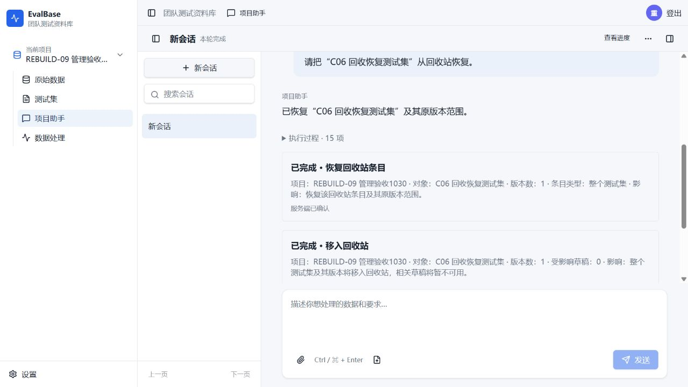
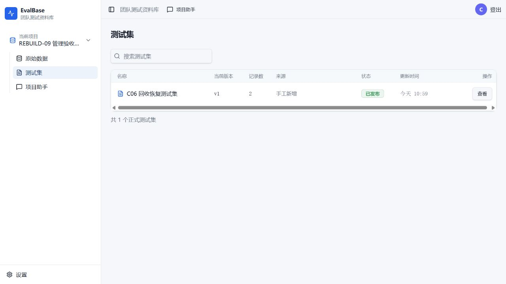
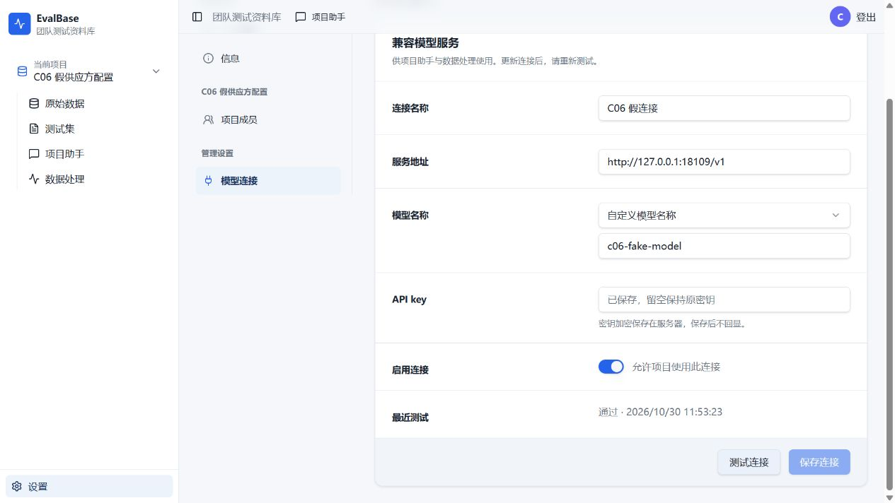

# REBUILD-09 实施与验收记录

基线 aef06a3，分支 codex/assistant-rebuild。Owner授权分阶段开发、回归、4240隔离预览及C06。现有验收数据、旧预算与已通过项保持，不合并或推送。

## 实现与当前证据

1. 账号、邀请和成员共享服务；回收、版本分支、恢复共享服务。人工HTTP和新工具复用权限、固定目标、事务内回执；模型不能自填操作者、项目、批准或快照。本人邀请重复接受读取当前角色，已移除不重新授权。
2. 模型配置由原生表单输入密钥并固定确认，输入不进入模型。保留修订冲突/换服务重新输入key；已保存连接测试复用配置服务及集中传输计量，单次HTTP入原账本，结果未知不自动重试。墓碑与永久删除由原生固定目标输入名称/版本号，复用既有接口及清理，模型无执行/自批通路。
3. 新增真实SDK及公开自动派发组合回归，涵盖邀请、防重、资料、角色变动、回收恢复、原生配置、过期/撤权等。源码定向验证及针对性双轴复审已完成，C06结果和范围见下文。

## 首次失败和定向补修

- SDK邀请确认后重放重新计算快照导致参数冲突：先找原操作/回执，当前目标仅在首次准备及实际提交时冻结/复核。
- 回收快照中的Date不能直接交给严格canonicalJson：SQL结果明确转为JSON时间表示后做快照，不放宽canonicalJson。
- 审阅发现移除成员摘要含undefined：省略无新角色字段；补移除/唯一回执SDK回归。
- 回收影响快照只含实际版本闭包及受影响草稿，恢复摘要含条目类型、根版本和版本数；补无关分支修改及多分支区分回归。
- 无效地址的URL refinement捕获并反馈校验错误。原生模型设置准备工具仅对schema-invalid endpoint允许共同有限纠错；服务器注册的策略不进入模型Schema，仍保护其他有效字段、角色/来源/执行工具；最终原生表单须用户确认，准备不产生请求或写入。补正/反向SDK回归。
- 管理确认在封存或过期活动中拒绝；0处理行次表示禁止处理，而不是阻断邀请/管理确认。补有界0行次与封存后确认拒绝回归。

受控测试全部创建独立随机数据库/合成数据，外部真实模型请求0。初次误选旧controlled-deletion测试依赖旧身份环境，12项在登录时403；未将其记为业务回归失败或通过，也未放宽身份规则。后续定向验证改用独立库与真实新入口，现有数据另行逐行审计。

当前已通过：15项R09定向及受影响共享纠错/身份/预算/摘要/业务边界，共79项；另账号5、模型连接4及原生表单页面验证已有通过证据。所有命令与首次失败日志保留本目录。最终结果以收口段为准。

## C06 实际执行与结果

新合成项目REBUILD-09管理验收1030，手工合成2条已发布测试集，0模型生成；新普通查看账号供邀请/权限验证。C06一个新会话，最多16次模型HTTP、0处理/生成、25分钟；其中4240实际助手最多15次，假供应方原生连接测试预留1次，合计不超过16。假配置使用另一独立数据库及4241页面，禁止修改4240现有真实连接。活动在实际执行前登记，旧活动不重开、不重置。Computer Use由GPT-6.1 Terra高决策，主线程转发侧栏工具，技术辅助和普通原生确认据实记录。

实现提交 `1c01134a5c7178c3037285914ccae06d19a8bbae` 已更新4240；health、ready及首页均200。仅重启隔离Web，原处理Worker未变，未迁移表结构；4217与正式环境未动。见[部署身份](preview-version.json)。

执行活动 `r09-c06-20261030`，会话 `assistant_37f15f57b85547f79316d045fede25db`。从2026-10-30 03:36:41Z至03:53:37Z，约16分56秒，活动已封存。主助手9次HTTP，独立原生假连接测试1次，合计10/16；0处理行次、0生成。全部实际助手HTTP为200；参数错误0、自动纠正0、业务提示人工补救0。未续开旧活动或重置任何旧预算。

| 场景 | 实际入口与结果 |
| --- | --- |
| 邀请成员 | 普通提示邀请合成查看账号；固定卡列项目、账号、角色及接受后生效条件；操作者确认后唯一邀请及回执。 |
| 测试集回收 | 同一会话普通提示回收人工合成测试集；卡片列1版本/0草稿影响；确认后唯一回收回执。 |
| 恢复 | 同一会话普通提示恢复；卡片列整个测试集/1版本；确认后唯一回执，列表及详情恢复v1的2条记录。 |
| 本人邀请/查看权限 | 合成查看账号原生登录、读取并接受本人邀请；仅可读已发布两条，成员页无管理控件，设置无模型入口，测试集无回收入口。未发送额外模型提示。 |
| 原生模型配置 | 4241、独立库及loopback假供应方：新配置由原生表单输入、固定确认后保存；确认不显示key，保存后不回显；一次测试通过，假供应方计数1。未接触4240真实连接。 |

普通提示仅为：邀请目标查看账号；把“C06 回收恢复测试集”移到回收站；从回收站恢复。没有向助手提供工具名、参数结构或纠错指导。三项业务各1操作/回执与1 committed确认卡。见[安全摘要及实际计量](C06-summary.json)。

人工与技术辅助：预先准备本轮合成账号/两条手工记录和独立假供应方；原生登录、本人接受邀请、固定确认及输入合成key为正常产品协作。电脑操作由GPT-6.1 Terra高作决策，主线程转发其指令控制侧栏IAB；没有伪称主线程模型已切换。旧IAB绑定故障通过同一浏览器新标签恢复；一次测试定位器误称“模型设置”超时，读取DOM中的“模型连接”后恢复，属于测试操作问题，未计为产品错误。

验收边界：CU未执行角色调整、原始越权HTTP、永久删除或墓碑；这些权限、角色变更、修订冲突、撤权/过期和名称输入约束由受控真实SDK/HTTP/页面回归及既有R08清理证据覆盖，不写成CU通过。C06仅证明本次纵向场景通过，不等于全功能无缺陷或全库测试通过；跨票完整切换仍归REBUILD-10。

保护审计：25张表的所有既有行按执行前列逐字段一致，含29个旧活动、旧账本、9条真实模型连接、旧成果与旧会话。新增合成对象及本轮活动保留。见[保护摘要](preservation-summary.json)。

## 收口

- 受影响回归79通过/169按定向筛选跳过（4文件），其中15项R09；另外账号5项及模型连接4项在前轮定向命令通过。非全库测试，不相加虚报互不重叠总数。
- 后端/前端TypeScript、受影响格式检查、前后端构建通过；日志为 `final-regressions.log`、`types-final.log`、`frontend-types-final.log`、`lint-final.log`，部署构建见本轮预览记录。
- 两个审阅代理分别核对Spec和Standards；针对初审发现进行补修复审，没有未关闭P0/P1。未重跑既有C01～C05或其他已通过CU。
- 本票Implementation completed / Validation targeted-pass；无合并、推送或生产切换。

