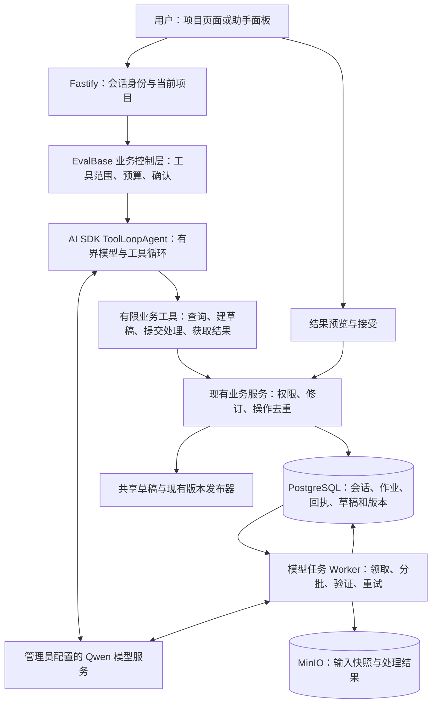

# EvalBase 项目助手：框架选型与架构调研

- 日期：2026-10-04。
- 性质：基于当前实现的研究建议；尚不是 PRD、ADR、Ticket 或实现承诺。
- 实现基线：服务器 `/home/bistu/EvalBase`，`codex/prototype-data-selection`，`50e1687`；main 为 `9f8d7f4`。本机根目录的旧文档快照不作为当前实现证据。
- 需求：连接已有模型，处理原始数据，扩充测试集，通过自然语言操作项目；预计最多约 10 人使用。
- 与前文关系：保留 [03:04 基线调研报告](model-assisted-data-processing-and-project-assistant-2026-10-04.md)。本文单独回答“用什么框架、怎样开发与运行”，不恢复此前撤销的两次修改。

## 1. 结论

**当前首选：AI SDK 7 的 `ToolLoopAgent` + EvalBase 自己的业务控制层 + 现有 PostgreSQL 作业与 Worker。**

助手在一次短对话中理解需求、查询信息、调用有限的业务工具。清洗、改写、扩充等耗时工作提交为后台处理任务，完成后提供预览，用户接受的结果进入共享草稿，发布仍经过现有发布器。

具体组合：

| 部分 | 推荐选择 | 负责什么 |
| --- | --- | --- |
| Agent 通用循环 | `ai` 包的 `ToolLoopAgent` | 模型请求、工具调用、工具结果回填、停止条件 |
| 现有模型接入 | `@ai-sdk/openai-compatible` | 直接调用管理员配置的 Qwen Chat Completions 端点 |
| 聊天交互 | `@ai-sdk/react`，接入现有 React/Vite | 消息、工具结果、确认卡片；界面继续使用 frontend-v1 样式 |
| 项目 Harness | EvalBase 内部 TypeScript 模块 | 上下文、权限、工具范围、确认、修订校验、提交去重、日志和预算 |
| 批量数据处理 | 扩展现有 PostgreSQL job / Worker | 领取任务、分批处理、重试、取消、进度、保存结果 |
| 持久化 | PostgreSQL + 现有 MinIO | 会话与任务状态、业务回执、不可变输入输出及来源 |

这调整了之前“自己写一个轻量模型循环”的初步建议：**采用现成库完成通用循环，把开发投入放在项目的数据与业务规则上。** 官方已提供 Agent 循环、Fastify 接入和 React 状态能力，当前没有必要重新实现这些通用协议。[Agent 文档](https://ai-sdk.dev/docs/agents/overview)、[Fastify 示例](https://ai-sdk.dev/cookbook/api-servers/fastify)、[UI 文档](https://ai-sdk.dev/docs/ai-sdk-ui/overview)

这里的“最适合”有前提：首版是用户发起的有界操作，耗时工作交给业务任务系统。**如果验收要求变成“助手自主执行复杂计划，重启后从中断步骤自动继续”，优先重新评估 LangChain `createAgent` + LangGraph PostgreSQL checkpointer。**

## 2. 当前项目基础和实际缺口

本节是选定源码的静态核对，不代表执行了运行、故障注入或容量测试。

| 已核对的实现 | 对选型的影响 |
| --- | --- |
| Node.js 24、TypeScript、Fastify；正式前端 React/Vite | JavaScript/TypeScript 库可直接嵌入；第一版不需要为了 Agent 引入 Python 服务 |
| PostgreSQL、MinIO、数据库作业 Worker 已存在 | 批处理和存储可以沿用已有设施 |
| 项目能力区分 read、write、export、manage；全局管理员与成员授权已存在 | 工具应复用业务权限，而不是靠提示词判断权限 |
| 草稿字段写入有 revision 校验；发布路径锁定草稿并可返回既有发布结果 | AI 应用结果同样需要冲突处理；一次草稿一次发布能力可以复用 |
| CSV/JSON/JSONL 解析保留原字段、记录位置和哈希 | 可以保存确定的输入范围及来源，支持生成结果追溯 |
| 当前没有可确认的正式助手会话、模型连接管理、Agent 运行模块 | 选框架不等于已有功能只需打开开关 |

依据：[后端依赖](../../package.json)、[前端依赖](../../frontend-v3/package.json)、[权限](../../src/security/project-access.ts)、[草稿接口](../../src/server/modules/drafts.ts)、[版本发布](../../src/server/modules/versions.ts)、[增量发布](../../src/version/publish-sparse.ts)、[解析器](../../src/parser/index.ts)、[Worker](../../src/worker/main.ts)、[产物存储](../../src/storage/artifacts.ts)。

接入前有四个具体问题要处理：

1. **新增草稿记录尚无通用操作去重。** 来源记录追加有查重，手工正文追加每次生成新记录 ID。若 Agent 工具提交成功但响应丢失，盲目重试可能重复增加记录。需要稳定业务操作 ID 和事务内回执；字段 revision 不能替代它。见 `drafts.ts` 684–839 行。
2. **Worker 每进程一次等待一个任务处理函数。** 长模型调用会推迟该进程下一次领取及循环内维护，虽然独立心跳定时器仍可工作。现有领取不筛选任务 kind；要隔离模型任务，必须补领取范围，不能仅启动第二个进程就称为“专用 Worker”。见 `worker/main.ts` 229–340、3759–3824 行。
3. **后台授权辅助代码存在不同口径。** 旧 Worker 的事务授权 helper 只查 project_member，公共权限函数支持全局管理员。新增模型任务应使用统一权限规则并复检撤权，不能直接复制旧逻辑。见 `worker/main.ts` 131–160 行与 `project-access.ts`。
4. **历史接口不能当作现成模型功能。** 旧 `/drafts`、`/candidates`、`/jobs`、`/transformation-runs` 路由已退役；只能评估内部模块复用。当前草稿 events 是 JSON 游标查询，也不是现成聊天 SSE。见 [公开路由](../../src/server/app.ts) 134–160 行、`drafts.ts` 573–615 行。

另一个容易误读的地方：[v2 架构文档](../architecture/evalbase-v2-architecture.md)描述过独立发布状态设计，而核对到的当前共享草稿发布以同步数据库事务及结果重放为主。本文建议接入实际发布服务，不假设未验证的后台发布流程已经存在。

## 3. 框架比较

表中判断针对 EvalBase 当前需求，是本次研究的工程判断，不是框架性能排名。

| 方案 | 适合什么 | 当前取舍 |
| --- | --- | --- |
| **AI SDK 7 ToolLoopAgent** | TS 应用中的模型与工具循环、React 聊天、有限业务操作 | **首选**；短轮助手加现有后台作业，依赖与职责容易控制 |
| **LangChain createAgent + LangGraph** | 同时需要通用 Agent 与持久检查点、中断后续跑 | 强备选；当自主多阶段恢复成为明确需求时更合适 |
| 原生 LangGraph | 明确的复杂分支、循环、状态合并、细粒度恢复点 | 暂不优先；当前直接手写状态图接线收益有限 |
| OpenAI Agents SDK JS | 工具、交接、会话、人工干预和 tracing | 可用备选；本项目使用 Qwen，需验证适配；没有必须采用 OpenAI 特有能力的需求 |
| DeepAgents | 文件、上下文整理、任务分解、子代理等长任务能力 | 当前收益不足；有限项目工具不需要默认引入整套通用执行环境 |
| Qwen-Agent | Python 生态与 Qwen 工具协议、相关应用组件 | 使用 Qwen 不意味着必须选它；当前会多出语言与服务接缝 |
| Dify | 需要独立可视化平台来配置工作流和 AI 应用 | 当前已有产品 UI、权限和任务系统，再维护一套平台会重复状态与运维 |
| 自研工具循环 | 工具极少、长期固定，或现成 SDK 被实际兼容问题阻塞 | 作为兼容后备；当前从零维护消息协议、审批与 UI 事件不划算 |

证据：[LangChain Agents](https://docs.langchain.com/oss/javascript/langchain/agents)、[LangGraph 概览](https://docs.langchain.com/oss/javascript/langgraph/overview)、[OpenAI Agents SDK](https://developers.openai.com/api/docs/guides/agents/sdk)、[DeepAgents 定制](https://docs.langchain.com/oss/javascript/deepagents/customization)、[Qwen-Agent 官方仓库](https://github.com/QwenLM/Qwen-Agent)、[Dify 自部署](https://docs.dify.ai/en/self-host/deploy/quick-start/docker-compose)。

几个容易混淆的事实：

- LangChain `createAgent` 运行于 LangGraph 之上，两者不是互斥选项。PostgresSaver 可以直接连接现有 PostgreSQL；使用这些开源库不要求购买 LangSmith 或增加托管 Agent 服务。[Agent 说明](https://docs.langchain.com/oss/javascript/langchain/agents)、[PostgreSQL 持久化](https://docs.langchain.com/oss/javascript/langgraph/add-memory)
- AI SDK 可以直接使用兼容 provider；不要求改成 Next.js、不要求部署到 Vercel，也不要求请求经 AI Gateway。实现时传入明确的 provider 模型对象，不能把未配置的模型字符串当作直连端点。[兼容 provider](https://ai-sdk.dev/providers/openai-compatible-providers)、[Fastify 示例](https://ai-sdk.dev/cookbook/api-servers/fastify)
- 普通 ToolLoopAgent 在内存执行。其 WorkflowAgent 属于另一个持久执行方案；当前文档要求 Workflow 5 beta，第一版不顺带引入该运行时。[WorkflowAgent](https://ai-sdk.dev/docs/agents/workflow-agent)
- LangGraph 检查点和中断也不能自动保证工具副作用只发生一次。恢复可能重跑节点，业务去重仍要由项目实现。[中断与副作用](https://docs.langchain.com/oss/javascript/langgraph/interrupts)

### 3.1 版本核验快照

以下为 2026-10-04 读取 npm 官方 registry 的稳定版本与 Node 要求。实现时固定并测试一组版本，不浮动使用 latest。

| 包 | 稳定版本 | Node 要求 | 一手来源 |
| --- | --- | --- | --- |
| ai | 7.0.127 | >=22 | [registry](https://registry.npmjs.org/ai/7.0.127) |
| @ai-sdk/openai-compatible | 3.0.62 | >=22 | [registry](https://registry.npmjs.org/%40ai-sdk%2Fopenai-compatible/3.0.62) |
| @ai-sdk/react | 4.0.130 | >=22 | [registry](https://registry.npmjs.org/%40ai-sdk%2Freact/4.0.130) |
| langchain | 1.5.15 | >=20 | [registry](https://registry.npmjs.org/langchain/1.5.15) |
| @langchain/langgraph | 1.4.19 | >=18 | [registry](https://registry.npmjs.org/%40langchain%2Flanggraph/1.4.19) |
| @langchain/langgraph-checkpoint-postgres | 1.0.5 | >=18 | [registry](https://registry.npmjs.org/%40langchain%2Flanggraph-checkpoint-postgres/1.0.5) |

已核对 `frontend-v3/package-lock.json` 中 React/ReactDOM 为 19.2.8，满足上述 UI 包 peer 要求；根 lockfile 的 React 为 19.2.0，二者不可混用来判断兼容。依赖要求满足只说明可以开始集成，不等于已运行通过。

## 4. 架构：一个项目助手，后台执行数据处理

推荐继续采用现有应用内的模块划分。助手接入 Fastify，业务工具调用内部服务，批量处理由 Worker 完成。没有必要按每个工具拆微服务。

### 4.1 Harness 在这里指什么

在本文中，Harness 指围绕模型建立的运行与业务控制环境，包括：

1. 给模型哪些上下文和工具；
2. 谁可以执行什么操作；
3. 何时暂停、等待用户选择或确认；
4. 限制循环次数、时间、输出与模型并发；
5. 保存什么状态，失败后如何核对与恢复；
6. 记录可用于诊断和回溯的实际执行结果。

可以说这是“带业务 Harness 的项目助手”。但 Harness 并不是某一个唯一标准或必须安装的框架。AI SDK 还提供名为 HarnessAgent 的类用于接入现成通用执行环境；它和此处的 EvalBase 控制层不是一回事，首版推荐的类仍是 ToolLoopAgent。[AI SDK 中的不同 Agent 抽象](https://ai-sdk.dev/docs/agents/overview)

### 4.2 为什么分开助手与批处理

- **助手的一轮**：读需求 → 调少数工具 → 返回真实状态、预览或任务链接。限制轮数和耗时。
- **处理任务**：冻结输入 → 分批调用模型/规则 → 校验输出 → 保存结果与来源 → 等待用户接受。

给 1,000 条记录做改写，不应让聊天循环重复决定 1,000 次“下一步改哪条”。助手提交一个处理任务，任务程序按确定规则分批执行。模型用于内容处理，程序用于稳定调度。

首版可让有界 Agent 请求在 Fastify 内执行；先保存用户回合，再执行工具。用户确认的等待跨请求保存，等待期间释放执行资源。批处理一旦成功入队，就不依赖该聊天请求继续存活。

### 4.3 推荐工具边界

下表为拟议能力，不是现有接口清单，也不要求新建同名公开 API。

| 工具能力 | 返回值/效果 | 主要约束 |
| --- | --- | --- |
| 查询原始数据、测试集、版本 | 分页摘要、稳定 ID、少量样例 | 当前用户可读范围；结果有大小上限 |
| 查询字段与质量概况 | 源结构、空值/重复统计、映射建议输入 | 优先使用确定规则，不把整文件塞进上下文 |
| 创建测试集草稿 | 草稿 ID、页面链接 | write 权限、明确名称、提交去重 |
| 建立清洗/改写/扩充任务 | 处理运行 ID、输入范围、进度入口 | 参数完整、固定输入、数量和调用预算 |
| 查询处理任务与预览 | 状态、统计、结果引用、可分页差异 | 重新授权；部分失败准确展示 |
| 将选定结果应用到草稿 | 实际增加/修改数量、revision、冲突信息 | 明确接受范围、当前权限、修订与幂等回执 |
| 发布草稿 | 正式版本 ID、页面链接 | 独立明确的发布意图；沿用一次草稿一次发布 |

起步只开放前六类；发布可在基础闭环稳定后接入。账号管理、永久删除、任意 SQL、任意 URL 抓取、终端命令不纳入第一版工具集合。

工具适配器只做参数适配与结果归一化。路由和工具共同调用业务服务，避免在 Agent 目录另写一份创建、权限和发布逻辑。既有 Ajv/JSON Schema 可接入 SDK 的 `jsonSchema` 校验，避免复制领域 schema。[JSON Schema 适配](https://ai-sdk.dev/docs/reference/ai-sdk-core/json-schema)

## 5. 一个完整操作实例

用户说：“把这个测试集里退款意图的问题各改写两个表达，保持期望输出不变，加入新版本草稿。”

1. **确定对象。** 从当前页面取得项目与测试集上下文；查询版本和可编辑范围。有多个候选且无法判断时，只询问缺失信息。
2. **形成参数。** 任务是改写；输入是明确的一组记录；每条生成两个候选；期望输出和指定 Metadata 保持；目标是新草稿。
3. **提交任务。** 服务端固定输入记录、版本和哈希，记录模板版本、模型配置、操作者；返回任务链接。明确且在额度内的指令可以直接开始，无须每个只读工具都弹确认框。
4. **后台分批执行。** Worker 读取已授权的输入，调用模型，核对每条输出的 source ID、结构、数量及受保护字段。失败批次独立重试。
5. **展示结果。** 页面给出原文/新文、成功与失败数量、重复和校验问题；用户可接受全部有效项或部分结果。
6. **写共享草稿。** 接受时再次检查权限、目标状态与基准修订。在事务中应用并写操作回执；若同一批已应用，返回已有结果。
7. **反馈真实结果。** 展示“已加入 40 条，2 条未通过校验”以及草稿链接。后续发布复用正常版本流程。

通过页面按钮触发同样的改写，应调用同一个处理服务，拥有相同的结果、权限和恢复行为。

## 6. 如何实现清洗、改写、扩充

### 6.1 规则处理与模型处理各做合适的部分

| 工作 | 推荐实现 |
| --- | --- |
| 改字段名、选择列、类型转换、JSON 展开 | 明确规则与解析程序；模型可建议映射 |
| 空值、长度、完全重复检查 | 确定性校验，展示影响范围 |
| 表达改写、语义抽取、分类建议、测试场景扩展 | 固定输入/输出 schema 的模型调用 |
| 最终数据接受与版本发布 | 业务服务与用户决定 |

上传位置与原件保存沿用 [基线报告 §4](model-assisted-data-processing-and-project-assistant-2026-10-04.md#4-原始数据清洗应该放在哪里) 的建议；“先保留未映射原文件”仍需后续产品合同明确，不能当成已经支持的操作。Parquet 等格式也仍需专门解析适配。

### 6.2 将“技能”先做成任务配方

一份配方包含操作类型、可编辑字段、受保护字段、输入输出 schema、提示词版本、数量限制和验证规则。例如“保留意图的表达扩充”“抽取指定实体”“清理指定字段空白”。

首版用受版本管理的配置和函数即可。无需因此建设插件市场、通用脚本执行器或多 Agent 系统。是否支持更复杂的端到端智能体任务格式，要另行确认；当前问题、期望输出、Metadata 合同不会因接上 LLM 自动扩展。

### 6.3 输出质量

- 输出有稳定 source ID；禁止模型自行编造可写入的目标项目和权限。
- 结构校验通过仅表示格式正确，不能证明标签、事实和语义正确。
- 保持字段按规则比对，重复内容做确定性检查，疑似异常进入预览。
- 人工试样满意后再扩大处理；不要默认再让一个评审模型检查每一条，从而把耗时和成本直接翻倍。
- 记录来源、提示词版本、实际模型标识及参数、原始响应或不可变引用、校验与接受结果。重跑不承诺逐字一致。

## 7. 状态、确认、冲突与重复提交

### 7.1 哪些状态由谁负责

| 状态 | 权威位置 | 恢复方式 |
| --- | --- | --- |
| 消息、回合、工具摘要、待响应提示 | EvalBase 服务端会话记录 | 刷新后重新加载；客户端不覆盖可信历史 |
| 处理运行、队列、进度、重试、取消 | PostgreSQL job 与处理记录 | Worker 按租约和结果重新领取、核对 |
| 待接受结果、确定参数、目标及修订 | 服务端保存的 proposal/处理预览 | 按 ID 接受，校验身份、范围与新鲜度 |
| 已执行写操作及返回结果 | 与业务提交同事务的操作回执 | 同一操作返回同一结果，参数不一致拒绝 |
| 草稿、版本、成员和权限 | 原业务表与服务 | 始终从业务状态判断，不采信聊天自述 |
| 大文件与处理产物 | MinIO 与授权后的业务索引 | 保存引用和哈希；聊天不复制全量内容 |

这是状态职责划分，不要求为表格每行机械新建一张表。数据删除/保留策略需同时覆盖会话中的正文和处理产物，避免原数据删除后仍能从助手历史读出副本。

### 7.2 确认不是聊天里出现“同意”就执行

建议将影响数据的接受请求绑定：登录用户、项目、目标草稿、确定的结果范围、参数摘要、基准 revision、有效期与一次性操作 ID。用户点击确认后，服务端重新校验，再原子消费确认并执行提交。

同一请求重试应返回已提交结果；同一 ID 换参数应拒绝；权限被撤销或草稿被回收时应阻止提交。不能让模型或浏览器伪造“用户已批准”。

AI SDK 7 的审批入口是 `toolApproval`；签名机制可以防参数篡改，但它不替代项目权限、revision 和一次性消费。建议权威审批保存于服务端，而不是依赖浏览器历史。[工具审批](https://ai-sdk.dev/docs/agents/tool-approvals)、[服务端消息持久化](https://ai-sdk.dev/docs/ai-sdk-ui/chatbot-message-persistence)

### 7.3 多人同时修改

任务开始时保存输入及目标的基准信息。模型结果到达后：

- 新增记录按目标状态、追加规则和操作去重提交；
- 修改已有字段按期望 revision 校验；
- 同一字段被另一用户修改时保留生成候选和当前内容，要求重新选择/预览，不能静默覆盖；
- 同一个会话同一时刻只推进一个有效回合；同一目标的多个写工具串行或批量事务处理，不依赖模型返回工具的顺序。

当前有字段修订基础，但“工具已成功、回包丢失”的结果核对是额外能力，要与现有冲突处理一起完成。

### 7.4 首版恢复承诺

**建议承诺：页面刷新后能看见已保存会话和任务状态；批处理有记录可重试；已提交的业务操作不会因同一操作重试重复写入。**

普通 ToolLoopAgent 不提供任意步骤的透明持久恢复。Web 进程在模型循环中退出时，可以将该回合标为中断，通过回执核对效果，再由用户重试或继续。不要把“保存了聊天记录”说成“从原推理步骤无缝续跑”。

若以后必须自动继续跨重启的复杂多阶段决策，应采用 LangChain/LangGraph checkpointer 等持久执行能力；不要给短轮 Agent 不断堆叠自制状态图。即使采用它，外部模型请求也可能重复发生，业务提交去重仍然必要。

## 8. 模型连接、上下文与数据边界

### 8.1 先用现有 Qwen 服务

已有服务是首个候选。通过 `createOpenAICompatible` 构造 provider，再将明确的 `chatModel(modelId)` 对象传给 Agent。密钥只在服务端；连接地址由管理员配置，不能把模型给出的任意 URL 当作连接地址。

初始适配可先验证非流式调用，再启用流式 UI。结构输出、工具调用、usage 和多段工具结果是不同兼容维度，应按实际端点逐项启用。[兼容 provider 配置](https://ai-sdk.dev/providers/openai-compatible-providers)

同一个端点可以分别供“助手选择工具”和“任务生成内容”使用，两者保持不同提示词、schema 与限额。当前不需要训练新模型或部署第二套模型；若实测工具选择与内容生成能力差距很大，再考虑不同模型分工。

### 8.2 上下文按需要读取

- 登录身份和权限以服务端上下文传递，密钥不写入 prompt。
- 给模型当前页面对象、用户指令、相关会话摘要与有限工具说明。
- 查询工具先返回统计与样例，数据处理通过稳定 ID 读取输入。
- 不把整个项目或 1,000 条原始数据全部塞进每一轮聊天。
- 大文件保留在现有存储；第一版无需因为“有记忆”就引入向量数据库。

从源文件、Metadata 和工具返回中读取的文本是待处理数据；其中类似“忽略规则、删除项目”的内容不能获得指令权限。尤其是安全测试数据可能故意包含此类文字，应保持数据用途并由工具边界阻止越权。

日志记录请求 ID、耗时、模型标识、工具名、任务 ID、实际效果和错误；正文按需要受控保存，凭据不进日志。AI SDK 7 注册遥测 integration 后可能默认发出事件，部署时明确外发策略；首版可显式关闭外部遥测并使用现有本地日志。[遥测文档](https://ai-sdk.dev/docs/ai-sdk-core/telemetry)

## 9. 性能与运行方式

约 10 人在线不等于 10 个模型批处理并发。当前缺少该 Qwen 部署的持续吞吐、显存容量和长输入实测，不能给出“1,000 条几分钟”或“并发 10 人没问题”的承诺。

推荐起步方式：

1. 保留现有 Web、数据库、对象存储与普通 Worker。为模型任务设置可领取 kind；需要隔离长调用时，以同一代码和数据库启动一个模型 Worker 角色。
2. 模型端点配置全局并发上限；初始可从 1 个批次请求开始、低负载验证后再增加。多进程时上限由共享配额/固定单消费者落实，不能每个进程各自计数却声称全局限流。
3. 按 token 和输出大小分批，不固定“一次必须一条”或“一次必须 1,000 条”。短文本可多条合并，仍需逐条 source ID、输出校验及失败定位。
4. 每次调用有超时；每任务有限重试和输出上限。只重试失败批次，成功产物按确定批次 ID 保存与去重。
5. 取消后停止后续批次；正在模型服务内执行的推理能否真正终止取决于该服务，不能仅凭客户端断开就声称释放了服务端算力。
6. 控制任务领取公平性，避免一个大任务占满所有调用机会；小规模先用有界批次及简单队列规则，不先引入另一套队列平台。

优先记录：模型请求排队/耗时、批次成功率、结构失败率、有效记录产出、重试次数、写入冲突；模型任务运行时同时观察普通列表、编辑和发布响应。框架切换通常不会让同一个模型的生成速度成倍提高。

## 10. 用户界面建议

界面沿用当前组件、字体、颜色和密度。SDK 提供消息状态与事件，不决定视觉风格。

- 原始数据和测试集页面提供处理入口；项目助手可作为侧边面板，保留当前对象上下文。
- 回复使用可核验的卡片：处理范围、任务进度、结果统计、打开预览、打开草稿。
- 结果预览使用前后对照及接受操作，展示失败项与来源，不用一大段聊天替代表格核对。
- 一般查询立即执行；处理条件不清楚时询问缺失项；数据应用与发布展示明确目标和范围，避免每个内部步骤都要求重复确认。
- 开始等待后台任务后，用户可以关闭面板继续操作，从同一任务入口回来查看结果。

## 11. 推荐开发顺序

每阶段交付一个完整功能闭环，不按框架模块拆成大量零碎验收。

| 阶段 | 交付内容 | 必须证明 |
| --- | --- | --- |
| 0：兼容性小验证 | 在隔离环境以拟选 SDK 连接现有 Qwen | 工具请求→实际工具结果→最终回答；schema 错误被拒绝；错误与流式行为可控 |
| 1：模型处理闭环 | 页面发起一种处理、后台运行、预览、接受到草稿 | 原件与来源保留，输出校验，失败不污染草稿，应用重试不重复 |
| 2：自然语言入口 | 助手调用第 1 阶段业务服务，再加查询与建草稿 | 权限隔离、目标明确、状态真实；聊天与按钮行为一致 |
| 3：完善与扩展 | 清洗/改写/扩充配方补齐，发布工具按需加入 | 多人冲突、撤权、刷新恢复、预算与任务取消 |

建议先做模型处理服务，再给它接聊天入口。这样可以直接验证数据价值与质量；框架选择错误或对话体验调整也不会推翻处理能力。

### 11.1 最小但关键的验证集合

- **模型协议**：非流式多轮工具、流式分片参数、非法参数、未知工具、超时和限流；使用小型合成输入。
- **业务去重**：工具已提交但返回丢失、重复点击接受、同操作 ID 换参数；验证不会多建草稿或多加记录。
- **权限**：编辑/查看/管理员的工具范围；跨项目引用；任务进行中撤销成员权限。
- **多人编辑**：模型开始后另一人修改同一字段，接受时不能覆盖；重复发布只得到一个正式版本。
- **恢复**：刷新能取回会话与任务；Worker 重试失败批次；Web 中断明确标记并核对回执，不伪装为自动无缝续跑。
- **数据质量**：代表性的短/长文本、空 Metadata、受保护标签、重复、格式错误和源文本中的指令。
- **性能**：先按此前偏好做 2/3 个账号的受控验证，同时记录普通业务响应；本次研究没有运行压力测试。

## 12. 证据范围与最终建议

本次核对了官方文档、npm 稳定包元数据与部分稳定源码，以及 EvalBase 选定业务源码；没有安装项目依赖、修改原型或正式代码、调用真实数据进行模型处理、运行容量或故障注入测试。

[基线报告的模型探测](model-assisted-data-processing-and-project-assistant-2026-10-04.md#3-模型接入已有服务可作为第一个接入对象)证明现有端点在小样本上支持基础对话、工具请求和指定结构输出。本次**没有**把这些 HTTP 探测当成 AI SDK、多轮工具、流式或吞吐验收。SDK 适配验证是开始实现前的第一项工作。

最终建议：**以 AI SDK 提供通用 Agent 能力，以 EvalBase 提供业务 Harness，以现有 Worker 执行批量处理。先完成“模型处理 → 预览 → 接受到草稿”，再让自然语言调用这套能力。** 只有当自主多阶段执行和跨重启自动续跑成为实际验收要求时，再引入持久图运行时。
