# EvalBase 系统流程图

2026-10-08 修订。图中账号、共享草稿和版本流程继承已交付 v2；助手要求、步骤核对与恢复部分为 [整改目标](assistant-remediation-plan.md)，尚未实施，状态见 [优化台账](../.scratch/assistant-optimization/spec.md)。本图不替代 [本轮 PRD](PRD-data-selection-and-assistant.md) 与 [v2 PRD](PRD-evalbase-v2.md)。

静态图：[PNG](system-flow-v2.png)；Mermaid 源文件：[MMD](system-flow-v2.mmd)。

2026-10-15 文档增补：[OPT-26–31 三批修复](assistant-generation-repair-batches.md) 尚未实施；图中虚线“按要求从零生成”表示计划新增路径，沿用后台处理、审核与确认。当前运行和历史修复的实际状态见优化台账。

## 1. 项目主流程

```mermaid
flowchart LR
    Login["登录 / 账号注册"] --> Projects["有权访问的项目"]
    Projects --> Space["当前项目"]
    Space --> Raw["原始数据"]
    Raw --> Upload["上传与解析"]
    Upload --> Confirm{"确认保存"}
    Confirm -->|完成映射| Mapped["已整理文件"]
    Confirm -->|稍后整理| Original["保留原件  待整理"]
    Confirm -->|取消| Cancel["无可见资产"]
    Original --> Mapping["整理字段"] --> Mapped
    Mapped --> Scope["选择来源文件"]
    Scope --> Filter["条件筛选  全部 / 随机"]
    Filter --> Preview["固定预览  补选 / 排除"]
    Preview --> Accept["核对并加入"]
    Space --> Draft["共享草稿  自动保存"]
    Accept --> Draft
    Draft --> Publish["创建不可变版本"]
    Publish --> Version["版本 / 来源 / 下载"]
    Version -->|派生| Draft
    Version --> Trash["回收 / 恢复 / 永久删除"]
    Space --> Assistant["项目助手  自然语言"]
    Assistant --> Requirements["当前生效要求  校验对象与字段"]
    Requirements --> Plan["简单操作或复杂任务步骤  能力预检"]
    Plan -->|已有执行授权| Tools["固定输入与参数  当前用户业务权限"]
    Tools --> Yield["保存结果  匹配回执与完成条件"]
    Yield -->|确定步骤有界续做| Plan
    Yield -->|需要语义决策| Assistant
    Tools --> Filter
    Tools --> Draft
    Tools --> Process["清洗 / 改写 / 扩充"]
    Original --> Process
    Mapped --> Process
    Version --> Process
    Draft --> Process
    Process --> Worker["后台分批处理  校验"]
    Assistant --> Background["私人背景文档"]
    Background -.-> Generation["按要求从零生成  OPT-29待实施"]
    Tools -.-> Generation
    Generation -.-> Worker
    Worker --> Result["进度与结果预览"]
    Worker -->|分类完成| Classified["固定分类结果"]
    Classified --> ClassifiedSelect["按类别选取与全量核对"]
    ClassifiedSelect --> Result
    Result --> Review["结构核对与内容审核分别呈现"]
    Review -->|用户确认采用  校验修订| Draft
    Review -->|用户确认保存派生文件| Mapped
    Review -->|规则或执行失败| Recovery["显示原因与已有成果  恢复未完成步骤"]
    Recovery --> Requirements
    Tools --> Result
    Space --> Settings["设置  信息 / 成员 / 个人资料"]
    Settings --> Connection["管理员模型连接"]
    Connection -.-> Assistant
    Connection -.-> Worker
```

## 2. 读图规则

- 登录身份与项目成员决定访问范围；仅管理员创建项目和管理模型连接。
- 原件经明确确认后保存，可先完成映射或稍后整理；原始字节不可覆盖，未整理记录不可作为已映射来源进入草稿。
- 选取依次经过来源范围、条件/抽样、固定预览、人工调整和确认；翻页不重抽，确认前不改变草稿。
- 草稿共享、字段离焦自动保存，同字段冲突保留输入；所有正式版本不可变，一份草稿只发布一次。
- 模型处理与助手共用业务服务；耗时任务后台分批执行，结果经明确接受才改变资料或草稿。用户离开助手界面不会丢失已入队任务。2026-10-14 的 [独立页面与稳定性方案](assistant-workspace-reliability-plan.md) 细化入口、恢复和审核，尚未实施；不改变图中的业务阶段及确认顺序。
- 只要求方案时保持规划状态；简单操作不额外增加规划确认，已有执行授权后按固定参数与完成条件推进。预算结束保存进度并在原授权内有界续做；规则和执行失败先显示原因与成果再恢复，内容疑点留在审核环节。具体行为见 [PRD §7](PRD-data-selection-and-assistant.md#7-ai-04-项目助手)。
- 结构核对与内容审核分开呈现；分类后选取使用实际固定成果，缺额不误报完成；采用与发布仍分别由用户确认。
- 来源与修改保留真实来源、选取规则和模型处理；下载仍绑定选定正式版本，CSV 合同保持。
- 回收、恢复、墓碑和永久删除继续保护有效后代，同时覆盖新增处理副本及会话中的受影响内容。
- 图中的后台表示执行位置；界面使用处理进度和可恢复反馈，不展示数据库租约等内部机制。

## 3. 前后端职责

frontend-v1 永久只读，frontend-v3 直接复用其视觉与组件。筛选页依据当前数据选取原型；智能体按 Owner 本轮授权直接设计实现。服务端负责权限、容量、固定来源、校验、幂等、原子发布与删除保护。

PostgreSQL 保存身份、状态、关系和提交事实，MinIO 保存不可变文件与产物；Worker 复用现有作业系统。具体技术边界见 [实施架构](architecture/data-selection-and-assistant.md) 与 [ADR 0014](adr/0014-project-agent-and-processing-runtime.md)。
