# EvalBase 系统流程图

2026-10-26 文档修订。资料、协作草稿、版本与数据处理沿当前业务合同；蓝色虚线框和新助手入口表示[独立重建目标](architecture/assistant-rebuild.md)，尚未实施或切换。本图不等于部署状态，也不改签历史验收。

静态图：[PNG](system-flow-v2.png)；Mermaid 源文件：[MMD](system-flow-v2.mmd)。产品依据：[助手 PRD](PRD-data-selection-and-assistant.md#assistant-rebuild-product)、[v2 PRD](PRD-evalbase-v2.md)；人工操作覆盖见[能力清单](assistant-rebuild-capabilities.md)。

## 1. 项目主流程

```mermaid
flowchart LR
    Login["登录 / 账号注册"] --> Projects["有权访问的项目"]
    Projects --> Space["当前项目"]
    Space --> Raw["原始数据 / 集合"]
    Raw --> Upload["上传与解析"]
    Upload --> Confirm{"确认保存"}
    Confirm -->|完成映射| Mapped["已整理文件"]
    Confirm -->|稍后整理| Original["保留原件 待整理"]
    Confirm -->|取消| Cancel["无可见资产"]
    Original --> Mapping["整理字段"] --> Mapped
    Mapped --> Scope["选择来源文件"]
    Scope --> Filter["条件筛选 全部 / 随机"]
    Filter --> Preview["固定预览 补选 / 排除"]
    Preview --> Accept["核对并加入"]
    Space --> Draft["共享草稿 自动保存"]
    Accept --> Draft
    Draft --> Publish["确认发布 不可变版本"]
    Publish --> Version["版本 / 来源 / 下载"]
    Version -->|派生| Draft
    Version --> Trash["管理员 回收 / 恢复 / 永久删除"]
    Space --> Settings["设置 个人资料 / 成员 / 模型"]
    Space -.-> Assistant["新助手入口 重建目标"]
    Assistant --> Context["当前目标 / 页面对象 / 有效勾选"]
    Context --> Runtime["开源运行时 工具循环 / 检查点"]
    Runtime -->|只给方案| Plan["查询与规划 不写业务数据"]
    Runtime -->|明确执行| Tools["受权业务工具 共享提交保护"]
    Tools --> Filter
    Tools --> Draft
    Tools --> Process["清洗 / 改写 / 扩充"]
    Tools -->|当前角色及必要确认| Settings
    Tools -->|管理员及删除确认| Trash
    Tools -->|受权下载| Version
    Original --> Process
    Mapped --> Process
    Version --> Process
    Draft --> Process
    Assistant --> Background["私人背景 / 真实证据"]
    Background --> Generate["按要求从零生成"]
    Tools --> Generate
    Process --> Worker["既有 Worker 固定输入 / 分批处理"]
    Generate --> Worker
    Worker --> Result["当前成果 / 轮次 / 真实回执"]
    Tools -->|提交后持久等待| Wait["作业关联与终态核对"]
    Result --> Wait
    Wait -->|同一所有者 / 有效授权与额度| Runtime
    Result --> Review["结构核对 / 人工内容审核"]
    Review -->|用户确认采用 / 复检修订| Draft
    Review -->|用户确认保存派生文件| Mapped
    Runtime --> Control["暂停 / 有界恢复 / 预算"]
    Control -->|仅未完成工作| Runtime
    Space --> Legacy["旧会话兼容读取 / 成果链接 / 原预算"]
    classDef rebuild fill:#eef5ff,stroke:#3b82f6,stroke-dasharray:5 5,color:#1f2937
    class Assistant,Context,Runtime,Plan,Tools,Wait,Control rebuild
```

## 2. 读图规则

- 登录身份与当前项目权限限制所有读取和写入。管理员管理项目成员、模型连接及回收/删除；助手不能扩大页面角色。
- 上传经确认后成为可见资产，可先保存原件再整理；原始字节不可覆盖。未整理资料不冒充已映射记录。
- 选取仍经过范围、规则、固定预览、人工调整及确认；翻页不重新抽样。草稿字段离焦保存，同字段冲突保留输入；正式版本不可变。
- 新运行时承担通用对话与工具调用，业务工具调用页面共用服务。图中通向数据处理的箭头代表已获授权的业务命令，不代表模型自行批准采用。
- 用户只要求方案时仅查询和规划；普通明确执行不增加反复开工确认。字段编辑、资料/集合管理等详细动作见能力清单，不为每个按钮单独画工作流。
- 从零生成使用真实背景与生效要求；清洗、改写、扩充按各自输入合同执行。多轮处理、未选结果、保存回原草稿及另存仍由现有处理业务负责。
- Worker 终态与回执经持久关联返回运行时；后台等待不重复消耗模型查询。同一任务只能由一个运行时推进，不再回到旧计划编译和续步控制器。
- 结构核对与内容审核分开，采用和发布分别由用户确认；成功以真实回执为准。模型总结失败不会抹掉已经保存的成果。
- 暂停优先使旧执行资格失效；查询不恢复；继续只做剩余且仍有权限和额度的工作。预算耗尽保留检查点，不自动加额。
- 旧会话读取不连接新执行链；打开历史不调用模型。明确承接未完成目标另按 PRD 核对成果、关联旧记录并授权新限额，旧预算不清零、不复制。
- 保留旧数据不取消删除/撤权保护；新检查点与缓存同样要对背景/来源失效作出响应。

## 3. 实施边界

frontend-v1 保持只读，frontend-v3 继续其视觉风格。新工具、原生文件/凭据输入、当前勾选、下载和固定确认通过受控页面协作；不为每个操作自动化点击浏览器。

PostgreSQL、MinIO、现有 Worker 和业务记录继续保留。旧框架选择及历史实现见[原架构](architecture/data-selection-and-assistant.md)与[ADR 0014](adr/0014-project-agent-and-processing-runtime.md)，新路径的职责、解耦、兼容及切换见[重建架构](architecture/assistant-rebuild.md)与[ADR 0015](adr/0015-assistant-rebuild-boundaries.md)。本次只更新文档和示意图，验收证据待后续获准执行。
